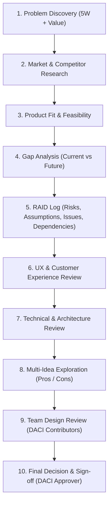

# Client Requirements Checklist Standard & Gatekeeper Agent Specification

This standard operationalizes the **Client Requirements Checklist** (`Client_Requirements_Checklist.xlsx`) as a continuous engineering gate within the GigaLibs SDLC.

---

## 1. The 10-Phase Client Requirements Framework

Every proposed capability, integration connector, or operational module must satisfy the criteria across these 10 phases:

### Phase 1: Problem Discovery (5W)
- **Who**: Target actor, tenant persona, and user role.
- **What**: Exact problem statement and operational friction.
- **Why**: Why this matters to the client's business (revenue, risk, compliance, operational latency).
- **When**: Delivery timeline, SLA, and release milestone.
- **Where**: Product area, platform layer (Ingress, Execution Plane, Control Plane), and geographical region.
- **Value**: Quantifiable value created for the client (hours saved, error reduction, cash flow optimization).

### Phase 2: Market & Competitor Research
- How do legacy competitors (SAP CPI, MuleSoft, Boomi, Workato, Celonis) solve this?
- What are the established industry standards (e.g. EIP, FIPS, OpenAPI, ISO 20022)?
- Where does GigaLibs create superior differentiation (e.g. zero-egress BYOM, cryptographic immutability, out-of-the-box business reconciliation)?

### Phase 3: Product Fit & Feasibility
- Does the feature fit natively into GigaLibs' operational intelligence architecture?
- Should it extend an existing workflow (e.g. `/ap`, `/ar`, `/analytics`) or introduce a dedicated experience?
- Does it maintain a seamless, frictionless interaction model?

### Phase 4: Gap Analysis
- **Current State**: Manual, batch, unverified, or fragmented external tools.
- **Future State**: Real-time, sovereign, cryptographically verified autonomous processing.
- **Functional Requirements**: Traceable to baseline `FR-01` through `FR-16`.
- **Technical Constraints**: Sandboxing, database partitioning, memory footprints, API quotas.
- **Dependencies & Risks**: Upstream APIs, partner availability, network reliability.

### Phase 5: RAID Log
- **Risks**: Evaluated and rated (High / Medium / Low) with active mitigations.
- **Assumptions**: Validated against real contracts and client operating constraints.
- **Issues**: Open operational or technical impediments with explicit owners.
- **Dependencies**: Target resolution dates and fallback recovery plans.

### Phase 6: UX & Customer Experience Review
- Intuitive layout and visual hierarchy.
- Simplicity and cognitive load reduction.
- Immediate clarity for first-time users without mandatory training.
- Measurable reduction in user clicks and manual entry steps.

### Phase 7: Technical & Architecture Review
- **Scalability**: Stateless processing, partitioned database queries, cursor pagination.
- **Maintainability**: Strict TypeScript types, modular folder structures, clean contracts.
- **Technical Debt**: Zero temporary bypasses, zero mock fallbacks in production paths.
- **Security & RBAC**: Sovereign tenant boundaries, zero-plaintext credentials, FIPS 186-4 SHA-256 digests.
- **Performance**: Sub-100ms API responses, client-side streaming, optimized bundle sizes.

### Phase 8: Multi-Idea Exploration
- Comparison of at least two viable architectural or UX approaches.
- Explicit evaluation of trade-offs, pros, and cons before finalizing implementation.

### Phase 9: Team Design Review
- Cross-functional review criteria across:
  - Product / Business Value
  - Solution Architecture
  - Frontend & UX Engineering
  - Backend & Integration Engineering
  - Quality Assurance & Automated Testing

### Phase 10: Final Decision & Sign-off (DACI)
- **Driver**: Leads execution and manages deliverables.
- **Approver**: Makes final go/no-go determination based on verified evidence.
- **Contributors**: Provide domain expertise and technical review.
- **Informed**: Stakeholders kept appraised of milestones and delivery status.

---

## 2. Agent Definition: `client_requirements_gatekeeper`

The `client_requirements_gatekeeper` subagent runs autonomously to evaluate user requests, architectural proposals, and pull requests against the 10-phase checklist before code is committed to production.

- **Agent Name**: `client_requirements_gatekeeper`
- **Trigger**: Invoked during discovery, planning, and architectural reviews.
- **Deliverable**: A structured **Requirement Evaluation Matrix** mapping the proposal to each of the 40 checklist items.
