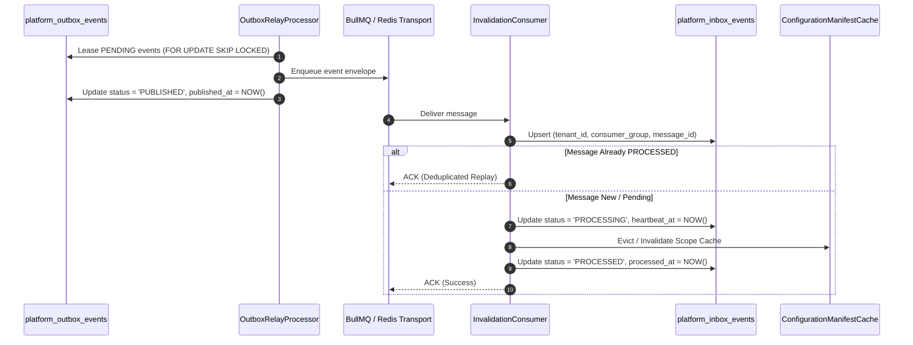

# TP-3 Architecture & Design Specification: Transactional Inbox & Consumer Event Conformance

- **Work Item:** WI-OI-049
- **Profile:** `configuration-local-development-v1`
- **Owning Roles:** Solution Architecture, Backend Domain, Integration / Event Systems
- **Target Gate:** Gate G3 Architecture & Design Baseline

---

## 1. Executive Summary & Objective

In **WI-OI-048 (TP-2)**, GigaLibs established the platform's canonical **transactional outbox** (`platform_outbox_events`), guaranteeing that configuration extension mutations (`tenant.profile.extensions.updated.v1`) and tenant export job updates commit atomically within PostgreSQL alongside entity mutations.

**WI-OI-049 (TP-3)** establishes the complementary **transactional inbox engine** (`platform_inbox_events`) and conforms the configuration invalidation and background consumer pipeline to Delta-5 resilience standards:
1. **Durable Ingestion & Idempotent Deduplication**: Consumer instances record incoming platform messages into a tenant-scoped durable inbox before executing side effects, rejecting duplicate deliveries within a configurable sliding window.
2. **Atomic Processing Handshake**: Consumer execution transitions messages through monotonic states (`RECEIVED` -> `PROCESSING` -> `PROCESSED` / `FAILED`), ensuring crashed workers leave verifiable recovery checkpoints.
3. **Poison-Pill Isolation & Dead-Letter Quarantine**: Unrecoverable processing failures are isolated to `DEAD_LETTER` after 5 exponential backoff attempts without blocking subsequent events in the tenant partition.
4. **Authoritative Persistence Boundary**: PostgreSQL remains the sole authoritative source of truth. Redis / BullMQ / `pg_notify` serve strictly as ephemeral wake-up transports.

---

## 2. Architecture & Data Flow



---

## 3. Database Schema: `platform_inbox_events`

```sql
CREATE TYPE "PlatformInboxStatus" AS ENUM (
  'RECEIVED',
  'PROCESSING',
  'PROCESSED',
  'FAILED',
  'DEAD_LETTER'
);

CREATE TABLE "platform_inbox_events" (
  "id" VARCHAR(30) PRIMARY KEY,
  "tenantId" VARCHAR(30) NOT NULL REFERENCES "tenants"("id") ON DELETE CASCADE,
  "consumerGroup" VARCHAR(64) NOT NULL,
  "messageId" VARCHAR(128) NOT NULL,
  "eventType" VARCHAR(128) NOT NULL,
  "aggregateType" VARCHAR(64),
  "aggregateId" VARCHAR(128),
  "payload" JSONB NOT NULL DEFAULT '{}'::jsonb,
  "status" "PlatformInboxStatus" NOT NULL DEFAULT 'RECEIVED',
  "attempts" INTEGER NOT NULL DEFAULT 0,
  "heartbeatAt" TIMESTAMPTZ(3),
  "availableAt" TIMESTAMPTZ(3) NOT NULL DEFAULT CURRENT_TIMESTAMP,
  "processedAt" TIMESTAMPTZ(3),
  "deadLetteredAt" TIMESTAMPTZ(3),
  "lastError" TEXT,
  "createdAt" TIMESTAMPTZ(3) NOT NULL DEFAULT CURRENT_TIMESTAMP,
  "updatedAt" TIMESTAMPTZ(3) NOT NULL DEFAULT CURRENT_TIMESTAMP
);

CREATE UNIQUE INDEX "platform_inbox_events_tenant_group_msg_idx"
  ON "platform_inbox_events"("tenantId", "consumerGroup", "messageId");

CREATE INDEX "platform_inbox_events_poll_idx"
  ON "platform_inbox_events"("consumerGroup", "status", "availableAt")
  WHERE "status" IN ('RECEIVED', 'PROCESSING', 'FAILED');

ALTER TABLE "platform_inbox_events" ENABLE ROW LEVEL SECURITY;
```

---

## 4. Key Conformance Invariants

1. **Strict Tenancy Partitioning**: All inbox operations filter by `tenantId`. No global cross-tenant queries.
2. **Idempotency Guarantee**: Identical `messageId` delivered multiple times to the same `consumerGroup` executes business logic exactly once.
3. **Stale Lease CAS Reclamation**: If a consumer crashes while in `PROCESSING`, secondary workers reclaim stale messages (`COALESCE(heartbeatAt, createdAt) < NOW() - 300s`) via Compare-And-Swap.
4. **No Double Invalidation**: Cache evictions and state mutations are transactionally bound to inbox updates.

---

## 5. Verification Matrix (TP-3 Gate G4 Baseline)

| Test ID | Name | Target Component | Acceptance Criteria |
|---|---|---|---|
| **TP3-INBX-01** | Exact-Once Ingestion Deduplication | `InboxConsumerService` | Duplicate message arrival yields exactly 1 processing cycle and 1 eviction. |
| **TP3-INBX-02** | Atomic Processing State Machine | `InboxConsumerService` | State advances `RECEIVED` -> `PROCESSING` -> `PROCESSED`. |
| **TP3-INBX-03** | Stale Consumer Lease Recovery | `InboxConsumerService` | Worker crash during processing is reclaimed via CAS lease timeout. |
| **TP3-INBX-04** | Dead-Letter Quarantine after 5 Retries | `InboxConsumerService` | Poison messages transition to `DEAD_LETTER` after 5 failures without blocking queue. |
| **TP3-INBX-05** | Cache Eviction Synchrony | `ConfigurationInvalidationConsumer` | Cache eviction only marks `PROCESSED` after cache invalidation succeeds. |
| **TP3-INBX-06** | Cross-Tenant Inbox Isolation | `platform_inbox_events` | Tenant B cannot access or replay Tenant A's inbox events under RLS. |
