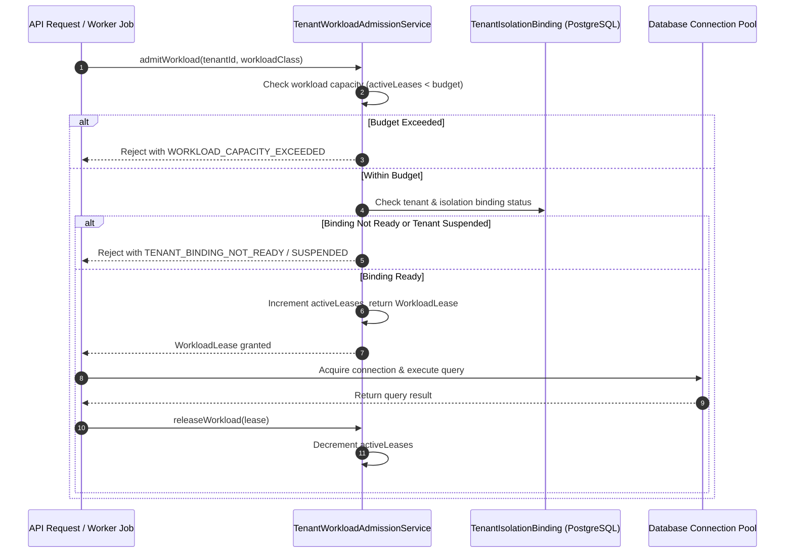

# TP-4 Architecture & Design Specification: Tenant Binding, Workload Pool & Admission Conformance

- **Work Item:** WI-OI-050
- **Profile:** `configuration-local-development-v1`
- **Owning Roles:** Solution Architecture, Backend Domain, Infrastructure / Observability
- **Target Gate:** Gate G3 Architecture & Design Baseline
- **Date:** 2026-09-25

---

## 1. Executive Summary & Objective

In **WI-OI-046 (TP-1)**, **WI-OI-048 (TP-2)**, and **WI-OI-049 (TP-3)**, GigaLibs established adapter-governed configuration extensions, durable tenant export jobs with the transactional outbox, and the transactional inbox engine with idempotent deduplication.

**WI-OI-050 (TP-4)** implements **Tenant Binding, Workload Pool & Admission Conformance**, fulfilling Section 5 of ADR-0005:
1. **Authoritative Binding Validation**: Extends runtime routing through the authoritative `TenantIsolationBinding` record. Workload operations explicitly verify that tenant isolation status is `READY` and tenant status is not `SUSPENDED` before admitting queries or background jobs.
2. **Workload Classification**: Classifies all control-plane operations into 4 certified workload classes:
   - `INTERACTIVE`: Tenant Profile and Configuration Studio synchronous HTTP API requests.
   - `BACKGROUND_WORKER`: Durable `TenantDataExportWorker` batch snapshot jobs.
   - `OUTBOX_RELAY`: `OutboxRelayProcessor` scheduled dispatching.
   - `EVENT_LISTENER`: `ConfigurationInvalidationConsumer` real-time PostgreSQL notifications.
3. **Connection Budget & Admission Control**: Enforces bounded concurrency budgets per workload class, preventing runaway queries or background tasks from starving database connection pools.
4. **Fail-Fast & Graceful Rejection**: Rejects saturated workloads with `WORKLOAD_CAPACITY_EXCEEDED` and invalid tenant bindings with `TENANT_BINDING_NOT_READY` before database connection acquisition.

---

## 2. Architecture & Workload Admission Lifecycle

---

## 3. Workload Classes & Admission Budgets

| Workload Class | Concurrency Budget | Timeout Budget | Target Execution Components |
|---|---|---|---|
| `INTERACTIVE` | 50 concurrent | 5,000 ms | `ConfigurationStudioService`, HTTP API controllers |
| `BACKGROUND_WORKER` | 10 concurrent | 60,000 ms | `TenantDataExportWorker` |
| `OUTBOX_RELAY` | 5 concurrent | 15,000 ms | `OutboxRelayProcessor` |
| `EVENT_LISTENER` | 5 concurrent | 10,000 ms | `ConfigurationInvalidationConsumer` |

---

## 4. Verification Matrix (TP-4 Gate G4 Baseline)

| Test ID | Name | Target Component | Acceptance Criteria |
|---|---|---|---|
| **TP4-ADM-01** | Standard Workload Admission | `TenantWorkloadAdmissionService` | Active tenant with ready isolation binding successfully acquires lease and decrements on release. |
| **TP4-ADM-02** | Suspended Tenant Rejection | `TenantWorkloadAdmissionService` | Suspended tenant is rejected with `TENANT_SUSPENDED` without acquiring database connections. |
| **TP4-ADM-03** | Unready Isolation Binding Rejection | `TenantWorkloadAdmissionService` | Binding in `REQUESTED`, `PROVISIONING`, or `FAILED` is rejected with `TENANT_BINDING_NOT_READY`. |
| **TP4-ADM-04** | Capacity Saturation Throttling | `TenantWorkloadAdmissionService` | Exceeding class concurrency budget immediately rejects with `WORKLOAD_CAPACITY_EXCEEDED`. |
| **TP4-ADM-05** | RAII Lease Safe Cleanup | `TenantWorkloadAdmissionService` | `withAdmittedWorkload` guarantees lease release even when wrapped task throws an exception. |
| **TP4-ADM-06** | Real-Time Workload Metrics | `TenantWorkloadAdmissionService` | `getWorkloadMetrics()` truthfully reports active leases and remaining headroom per class. |
