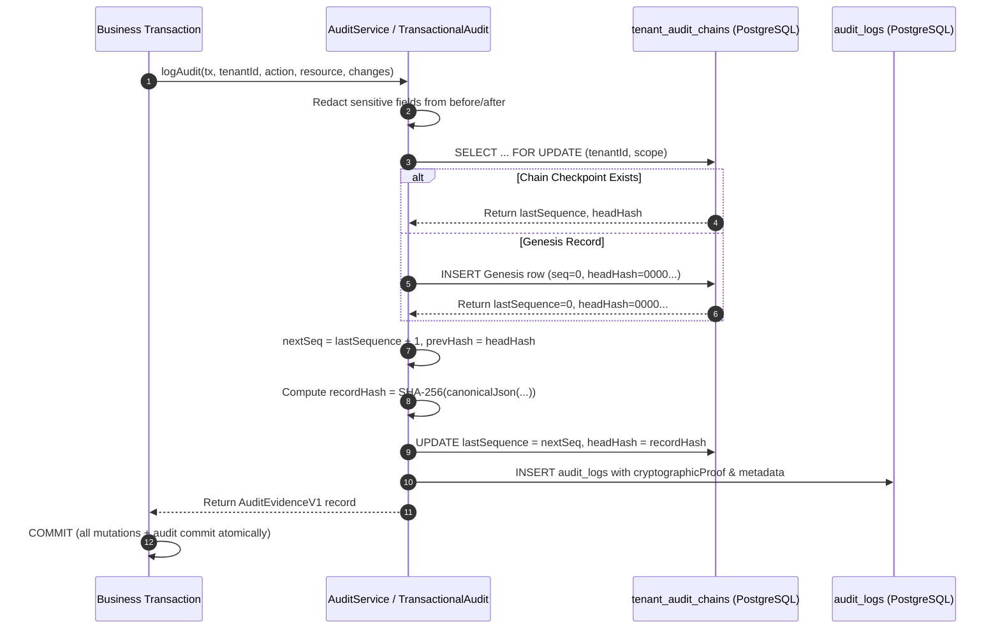

# TP-5 Architecture & Design Specification: Transactional Audit Conformance & Fail-Closed Evidence Verification

- **Work Item:** WI-OI-051
- **Profile:** `configuration-local-development-v1`
- **Owning Roles:** Solution Architecture, Backend Domain, Security & Privacy
- **Target Gate:** Gate G3 Architecture & Design Baseline
- **Date:** 2026-09-25

---

## 1. Executive Summary & Objective

In **WI-OI-046 (TP-1)**, **WI-OI-048 (TP-2)**, **WI-OI-049 (TP-3)**, and **WI-OI-050 (TP-4)**, GigaLibs established dynamic configuration manifests, durable tenant export jobs with outbox relay, transactional inbox deduplication, and tenant workload pool admission control.

**WI-OI-051 (TP-5)** implements **Transactional Audit Conformance**, addressing Section 6 of ADR-0005:
1. **Schema-Aware Field Redaction**: Automatically redacts sensitive parameters (`password`, `secret`, `apiKey`, `token`, `authorization`, `creditCard`, `totpSecret`, etc.) before audit persistence, recording explicit `redactedFields` in the evidence payload.
2. **Transaction-Safe Sequence Allocation**: Solves concurrent write forks by maintaining per-tenant audit chain state (`tenant_audit_chains`). Sequence allocation locks the checkpoint row using `SELECT ... FOR UPDATE` inside the database transaction, guaranteeing monotonic gapless sequences.
3. **Fail-Closed Verification States**: Verification evaluates and reports strict discrete states:
   - `VALID`: Perfect cryptographic hash continuity matching checkpoint.
   - `UNSEALED`: Records present without cryptographic seal.
   - `INVALID`: Tampered content, mismatched hash, or ruptured chain.
   - `INCOMPLETE`: Gap detected in sequence numbers.
4. **Audit Evidence Envelope (`AuditEvidenceV1`)**: Standardizes the evidence envelope schema across all control plane mutations and workers.

---

## 2. Architecture & Data Flow



---

## 3. Database Schema: `tenant_audit_chains`

```sql
CREATE TABLE "tenant_audit_chains" (
  "id" VARCHAR(64) PRIMARY KEY,
  "tenantId" VARCHAR(30) NOT NULL REFERENCES "tenants"("id") ON DELETE CASCADE,
  "chainScope" VARCHAR(64) NOT NULL DEFAULT 'default',
  "lastSequence" BIGINT NOT NULL DEFAULT 0,
  "headHash" VARCHAR(64) NOT NULL DEFAULT '0000000000000000000000000000000000000000000000000000000000000000',
  "sealedCount" BIGINT NOT NULL DEFAULT 0,
  "updatedAt" TIMESTAMPTZ(3) NOT NULL DEFAULT CURRENT_TIMESTAMP,
  CONSTRAINT "tenant_audit_chains_tenant_scope_key" UNIQUE ("tenantId", "chainScope")
);

ALTER TABLE "tenant_audit_chains" ENABLE ROW LEVEL SECURITY;
```

---

## 4. Verification Matrix (TP-5 Gate G4 Baseline)

| Test ID | Name | Target Component | Acceptance Criteria |
|---|---|---|---|
| **TP5-AUD-01** | Transaction-Safe Sequence Allocation | `AuditService` | Concurrent transactions for the same tenant allocate consecutive monotonic sequences with zero gaps. |
| **TP5-AUD-02** | Schema-Aware Field Redaction | `@gigalibs/audit-core` | Passwords, tokens, and secrets in before/after are masked with `[REDACTED]` and recorded in `redactedFields`. |
| **TP5-AUD-03** | Fail-Closed Gap Detection (`INCOMPLETE`) | `verifyAuditChain` | Missing sequence number returns state `INCOMPLETE` with `valid: false`. |
| **TP5-AUD-04** | Fail-Closed Tamper Detection (`INVALID`) | `verifyAuditChain` | Modified payload or broken hash returns state `INVALID` with `valid: false`. |
| **TP5-AUD-05** | Unsealed Record Detection (`UNSEALED`) | `verifyAuditChain` | Records without cryptographic proof return state `UNSEALED`. |
| **TP5-AUD-06** | Perfect Chain Verification (`VALID`) | `verifyAuditChain` | Unbroken sequence and hashes return state `VALID` with verified count. |
