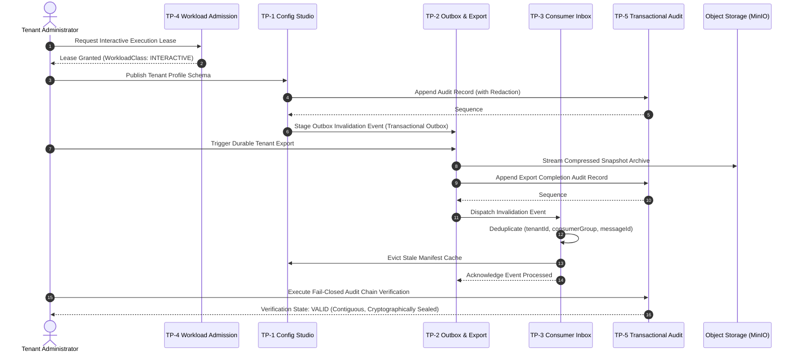

# TP-6 Integrated Reference Certification & Cohort Observation Design

- **Status:** Approved Architecture Specification
- **Work Item:** WI-OI-052
- **Adopter Target:** Tenant Profile Reference Adopter
- **Deployment Profile:** `configuration-local-development-v1`
- **Authors:** Solution Architecture, Backend Domain, Infrastructure Observability, QA/SDET
- **Date:** 2026-09-25

---

## 1. Executive Summary & Objective

The **Delta-5 Foundation** established five discrete, modular architectural capabilities:
- **TP-1 (WI-OI-046):** Configuration Studio Schema Adapter, Entitlements, Descriptor Registry, and Local Development Profile.
- **TP-2 (WI-OI-048):** Durable Tenant Export with CAS Lease Recovery, Object Storage Integration, and Transactional Outbox.
- **TP-3 (WI-OI-049):** Transactional Consumer Inbox with Idempotent Deduplication, Dead-Letter Quarantine, and Cache Eviction Synchrony.
- **TP-4 (WI-OI-050):** Tenant Workload Admission Control, Connection Pool Isolation, and Tenant Suspension Defense.
- **TP-5 (WI-OI-051):** Transaction-Safe Audit Sequence Allocation (`tenant_audit_chains`), Schema-Aware Field Redaction, and Fail-Closed Verification.

**TP-6 (WI-OI-052)** unifies these capabilities into an end-to-end executable cohort journey for the first-adopter `Tenant Profile` slice under the bounded `configuration-local-development-v1` profile. It provides a deterministic verification harness and observation report that validates the seamless execution of the unified platform foundation.

---

## 2. End-to-End Reference Cohort Journey

The reference cohort journey executes a stateful transition through each architectural tier:

---

## 3. Reference Verification Scenarios (TP-6 Matrix)

| Test ID | Journey Phase | Component Interaction | Verification Target |
|---|---|---|---|
| **TP6-INT-01** | Admission & Profile Publication | TP-4 + TP-1 | Workload admission admits publication; profile schema validates with non-empty fields. |
| **TP6-INT-02** | Transactional Audit & Redaction | TP-1 + TP-5 | Profile mutation emits audit log with credentials redacted and sequential chain hash generated. |
| **TP6-INT-03** | Durable Export & Outbox Staging | TP-2 + TP-4 | Export job creates durable archive and stages transactional outbox event. |
| **TP6-INT-04** | Inbox Ingestion & Deduplication | TP-2 + TP-3 | Outbox event ingested by inbox; duplicates rejected as `DEDUPLICATED`. |
| **TP6-INT-05** | Cache Eviction Synchrony | TP-3 + TP-1 | Invalidation event successfully evicts manifest cache in `ConfigurationManifestCache`. |
| **TP6-INT-06** | Fail-Closed Audit Verification | TP-5 | Full cohort audit trail is verified with `verifyAuditChain` returning `VALID`. |
| **TP6-INT-07** | Tamper & Fault Resilience | TP-5 + TP-4 | Injected payload tampering or suspended tenant triggers fail-closed rejection without state corruption. |

---

## 4. Verification Harness Specification (`verify-local-tp6-reference-cohort.mjs`)

A dedicated executable harness verifies the cohort journey programmatically:
1. Initializes tenant context with active isolation binding.
2. Simulates interactive tenant configuration write under admission control.
3. Records transactional audit log using `AuditEvidenceV1` and schema redaction.
4. Generates tenant export package and outbox event.
5. Ingests event into consumer inbox, validating idempotent deduplication.
6. Asserts cache eviction on configuration store.
7. Executes full tamper-evident audit chain verification across all emitted records.
8. Tests negative branches: suspended tenant admission rejection and corrupted audit chain tamper detection.

---

## 5. Non-Functional & Governance Bounds

1. **Zero Mock Data in Production:** All tests strictly run in isolated test suites or bounded development harness scripts.
2. **Protected File Integrity:** All 7 CMMS protected file hashes must remain completely untouched.
3. **Repository Audits:** All 6 SDLC audits (`api-boundary`, `package-dependencies`, `production-data`, `all-runtime-data`, `navigation`, `sdlc`) must stay 100% green.
4. **Single-Module WIP Limit:** Exactly 0 or 1 active implementation item at G4 Build at any time.
