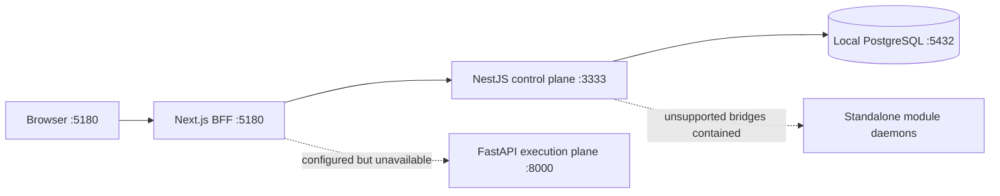

# GigaLibs identity, data-flow, asset and dynamic-configuration implementation plan

Assessment date: 2026-09-09  
Planning authority: WI-OI-037; proposed implementation owner: WI-OI-039  
Current Build item: WI-OI-013 only

This plan answers four connected questions: who a user is and what they may do; what a platform operator
may do across tenants; how source data reaches a workflow and a business result; and how modules can add
fields and layouts without source-code changes. It does not certify these capabilities as complete. The
[readiness audit](../audits/2026-09-09-readiness/README.md) and the broader
[module implementation plan](audit-remediation-implementation-plan.md) remain the evidence baseline.

## 1. Current runnable baseline

The local workflow application now responds on `http://127.0.0.1:5180`. Its canonical control plane is
running on `127.0.0.1:3333` against a dedicated `gigalibs_dev_runtime` PostgreSQL database on port 5432.
The database is owned by a restricted non-superuser role and has all 18 committed Prisma migrations. No
seed file or mock business dataset was installed.

A real HTTP verification passed five checks: control readiness; password-hashed account creation; no
invented default tenant; persisted tenant/owner membership and selected RBAC context; and logout
revocation. The attributable `[TEST]` records remain because audit rows are append-only. The evidence is
[live-local-runtime-results.json](../audits/2026-09-09-readiness/evidence/iam/live-local-runtime-results.json).
This proves only the narrow path exercised. The execution plane, providers, module daemons and human UAT
are not part of that result.



The app process will stop when this development session ends. A checked-in, secret-safe local runtime
command and service lifecycle are still required for repeatable developer startup.

## 2. Identity and tenancy: current state and target

The canonical schema has one global `User`, tenant-scoped `TenantMember`, `Tenant`, `TenantSettings`,
`Session`, `TenantInvite`, `Passkey`, `OTP`, `CustomRole` and `UserGroup` records. Having tables does not
mean their lifecycles are implemented.

The most confusing naming issue is `SUPER_ADMIN`. It is an enum value on `TenantMember`, so the current
database makes it a tenant membership role. A contracts comment calls it platform-level, but no canonical
platform-role assignment model or platform authorization guard exists. A global user account is not a
platform operator. These concepts must be separated before platform administration is exposed.

| Capability | Current verified or source-observed behavior | Missing or unsafe behavior | Required finished outcome |
| --- | --- | --- | --- |
| Self-registration | Real global user, password hash and refresh session | User becomes `ACTIVE` while `emailVerifiedAt` is null; no verification, rate-limit proof, bot control or terms record | User verifies address ownership, accepts current terms and can recover access without operator SQL |
| Login/refresh | Real password check, active-user check, persisted session, refresh rotation/replay denial | No failed-attempt ledger, device/session management, password reset or risk workflow | Suspension, expiry, reset and revocation take effect within the approved interval and are auditable |
| Tenant creation | User creates tenant, owner membership, settings and audit atomically | Any active user can create; no entitlement, domain proof, quota, provisioning job or complete browser journey | Authorized onboarding creates one usable tenant with recoverable provisioning states |
| Tenant activation | Owner can call the status API after selecting a `PROVISIONING` tenant | Browser has no complete activation; protected context rejects provisioning; prerequisites are unchecked | Idempotent readiness checklist changes to `ACTIVE` only when required identity, storage, modules and secrets are ready |
| Members | One built-in membership role persists and current role is loaded from DB | No list/add/update/suspend/remove API/UI, last-admin invariant or version conflict | Admin manages members; real business APIs immediately apply grants and revocations |
| Invitations | Table exists | No canonical create/list/resend/revoke/accept; token appears retrievable; no mail outbox/delivery state | Store token hash, persist delivery intent, accept once, support existing/new users and block cross-tenant use |
| Built-in RBAC | Hard-coded hierarchy resolves current membership permissions | `GUEST` unregistered; broad wildcards; no versioned catalog, resource or financial scope | Reviewed role versions govern every protected API/action with positive and negative evidence |
| Custom roles | `CustomRole` JSON rows exist | Not linked to membership or consumed by canonical RBAC | Tenant admin assigns a validated custom role that governs real operations without self-escalation |
| User groups | Rows store user-ID arrays | No API, referential integrity, role binding or audit lifecycle | Membership joins and group-role assignments produce deterministic effective policy |
| Platform users | Global users exist | No platform operator role/scope/guard, support boundary or separation of duties | Explicit platform-role assignments grant platform operations; tenant access needs a bounded support grant |
| Platform admin | Legacy `platform-rbac` has many routes | No visible guards; default `acme`, fabricated people/metrics and success-after-error fallbacks | Canonical guarded APIs provision/suspend tenants and inspect health without legacy fallback behavior |
| Tenant settings | Versioned JSON validates, updates atomically and audits | Called platform settings but tenant-only; stored security toggles are not enforced; flags are not entitlements | Every setting names an enforcement owner and shows pending/applied/blocked state |
| Platform config | None in the canonical control plane | No global defaults, environment policy, tenant overlay, approval or rollout | Versioned defaults resolve through permitted tenant overlays, dry-run, staged rollout and rollback |
| SSO/MFA/passkeys | Schema placeholders | No enrollment, challenge, recovery, domain proof, SAML/OIDC config or enforcement | Verified IdP/domain and MFA enrollment drive login; recovery is bounded and audited |
| Sessions/support | Logout revokes current session | No other-device revoke, admin revocation, step-up auth or support ledger | Users/admins manage sessions; support access is expiring, reason-bound, approved and tenant-visible |
| Audit | Append-only audit and some command writes | Coverage/normalization and retention/export verification incomplete | Every grant, invite, session, setting and support action is attributable without exposing secrets |
| Entitlements | Tenant has plan/features fields | No proven enforcement; authorization and commercial access are conflated in legacy code | Purchased capability enables a module independently from a user's action permission |

### Target authority model

1. `User` is an identity profile and carries no tenant/platform authority by itself.
2. `PlatformRoleAssignment` grants reviewed platform permissions with expiry and audit.
3. `TenantMembership` establishes belonging; `TenantRoleAssignment` links built-in/custom roles.
4. `SupportAccessGrant` is separately approved, expiring and limited to one tenant/reason.

Do not add a single role enum to `User`; assignment records support expiry, separation of duties and review.
JWTs identify user/session/selected tenant. Current DB assignments grant authority.

### User and tenant implementation slices

| Slice | Backend/data | Browser | Exit evidence |
| --- | --- | --- | --- |
| IAM-A account lifecycle | Pending verification, hashed verification/reset tokens, delivery outbox, attempts and device metadata | Verify/resend, forgot/reset, session list/revoke | Real mail sandbox; expiry/replay denial; reset/suspension revokes sessions; no plaintext token |
| IAM-B invitations | Invite aggregate, delivery state, expiry/revoke/accept and idempotency | Members, invite, pending, resend/revoke and accept | Wrong recipient/tenant denied; duplicate accept safe; outage never says “sent” |
| IAM-C members | Page/list, role/status/remove, version check, last-admin invariant and audit | Search/filter/edit/suspend/remove conflict states | Old token loses access; concurrent edits conflict; last active admin protected |
| IAM-D roles | Permission catalog, built-in versions, custom role/assignment joins and scoped constraints | Role builder and effective-access preview | Every route mapped; unknown permission and self-escalation denied |
| IAM-E platform ops | Platform roles/guard, tenant inventory/provision/suspend and support grants | Separate platform console and support banner | Tenant admin denied platform APIs; grant expiry and two-person high-risk review |
| IAM-F configuration | Platform defaults, tenant overlays, desired-state apply and enforcement receipts | Settings show pending/applied/blocked | Security setting affects login; dry-run has no effect; failed apply visible; rollback verified |
| IAM-G enterprise auth | Domain proof, OIDC/SAML keys, MFA/WebAuthn and recovery | Test-before-enforce setup/enrollment | IdP sandbox, key rotation, issuer/audience/domain negatives and lockout recovery |

## 3. Connector, workflow and business data flow

Two implementations compete. The canonical path is the NestJS control plane plus Prisma. Standalone
`universal-connector-hub` and `workflow-studio` use separate schemas and currently expose unguarded routes
and/or manufactured success. Their suite bridges remain unavailable pending consolidation and promotion.

Canonical connectors persist environment, credential reference, connection, profile, contract/version,
attempt, checkpoint, encrypted source event and control outbox. They support bounded HTTP/CSV, webhook,
PostgreSQL and file-upload interfaces. Credential records reference deployment or external-vault secrets.

Canonical workflows persist drafts and immutable versions, validate root/reachability/cycles, checksum the
definition and expose an execution spec. `WorkflowController` has no complete run/execute endpoint. The
control outbox sends validated events directly to AP ingestion, not a general workflow router. Thus the
visible connector and workflow surfaces do not form a universal end-to-end pipeline.

```mermaid
flowchart LR
    Provider[Authorized provider] --> Adapter[Connector adapter]
    Adapter --> Attempt[Attempt + checkpoint]
    Attempt --> Event[Encrypted source event]
    Event --> Contract[Published contract validation]
    Contract --> Outbox[Transactional outbox]
    Outbox --> AP[Current AP consumer]
    Outbox -. missing general route .-> Router[Event/workflow router]
    Router -. immutable spec .-> Executor[FastAPI execution]
    Executor -. signed result .-> Domain[Owning domain]
    Domain --> Receipt[Receipt/exception/reconciliation]
    Receipt --> Outcome[Visible business outcome]
```



| Submodule | Current strength | Missing completion | Business-ready result |
| --- | --- | --- | --- |
| Environment | Persisted tenant-scoped lifecycle | Desired-state activation, entitlement and policy | Admin knows why an environment is ready or blocked |
| Credential reference | Reference-only design and revoke propagation | Vault/provider proof, rotation and read/write separation | Revocation stops use; secrets never enter payload/DB response/log |
| Connection test | Real adapter calls and attempt/status records | Provider matrix, rate limits, retry and reconciliation | `READY` means selected operation succeeded with durable evidence and known limits |
| Profiling | Versioned inferred schema and masked samples | Inference is not contract; classification approval/drift policy missing | Data owner reviews profile/classification before ingest |
| Data contract | Draft/publish versions | Complete supported JSON Schema dialect/deep validation | Invalid nested/unknown/oversized data fails before domain effect |
| Ingestion | Encryption, idempotency and transactional outbox | General routing, consumer inbox, replay and mappings | One accepted event yields one domain command or visible exception |
| Webhook/file | Signature/time and object-store states | Provider replay, malware, retention and production object-store proof | Tampered/duplicate/late content denied; valid content traceable |
| Workflow definition | Draft, graph checks, version/checksum, secret scan | Node catalog/owner compatibility and honest UI | Only supported nodes publish with permission/retry/compensation metadata |
| Workflow execution | Separate execution-plane architecture | Canonical start route, leases/restart, receipts and result integration | Published version starts once, resumes and displays owner-issued effects |
| Business action | Approval records exist | Provider/domain execution and reconciliation are incomplete | `SUCCEEDED` requires a receipt; uncertain timeout requires reconciliation |

Implement versioned connection capability, event envelope, node catalog, execution command/result and domain
command/receipt contracts first. Add producer outbox and consumer inbox at every process boundary. Pin
connector, mapping, contract, rule and workflow versions to processed records.

## 4. Physical Operations CMMS and assets

CMMS has a substantial PostgreSQL migration and real SQL services. It remains proposed/quarantined under
WI-OI-038; the suite bridge is unavailable and no module-local source tests were located. Its UUID tenant
registry/OIDC claims are not yet mapped to canonical CUID tenants/memberships. Insecure development OIDC can
mint full-permission tokens for a supplied tenant; production config blocks the flag, but promotion evidence
is absent.

| Submodule | Foundation | Missing or defective | Finished outcome |
| --- | --- | --- | --- |
| Locations | Tenant-filtered hierarchy CRUD/soft delete | Cycle/move/dependency policy, version predicate and central tenant mapping | Valid site hierarchy used consistently by assets/work |
| Categories/forms | Tables and asset foreign keys | No category/schema API; duplicate owners; `specs` not server-validated | Published asset type validates every record against pinned version |
| Assets | Real CRUD/search/tag/parent/location/spec JSON and some audit | Mutation/audit not atomic; nullable clear/version conflicts/assignment eligibility/files/downtime incomplete | Concurrent edits stay consistent with documents, downtime and valid assignments |
| Work orders | CRUD/search/status/history and related tables | `COUNT+1` races; state/history/outbox not atomic; no conditional version; checklist/labour/cost/signature APIs incomplete | Technician performs/evidences/completes once and asset restoration is durable |
| Meters/IoT | Meter/readings and ingest permission | Partitions end Dec 2026; no device identity, dedupe, calibration or late policy | Authenticated quality-scored reading stored once and can drive one decision |
| PM schedules | CRUD and manual trigger | No durable scheduler; WO create/advance split; no occurrence key/DST/catch-up policy | Each occurrence creates at most one WO across restart/concurrency |
| Parts | Parts, transactions and restock outbox rows | Transaction/balance/outbox split; read-calculate-write race; transfer/procurement incomplete | Consumption is atomic/idempotent; restock waits for procurement receipt |
| Labour/cost | Tables | No full API/UI, authorized rates, currency or finance handoff | Approved labour/parts reconcile to work and finance policy |
| Vendors/customers/requests | Tables | No located services; ownership overlap; request-to-WO absent | Accepted request links one governed WO to canonical parties |
| Files/downtime | Tables | No upload/security/retention or interval lifecycle APIs | Authorized evidence and actual intervals drive metrics |
| Analytics | SQL work/asset/inventory aggregates | No freshness, currency normalization, quality markers or domain acceptance | Metrics trace to records and approved definitions; missing data visible |
| Audit/outbox | Tables and some writes | Partial coverage; no publisher/consumer; several non-atomic writes | Transition and event commit together and delivery reconciles |

The bounded release is location/asset setup → maintenance request → assigned work order → required evidence
→ atomic parts/labour → completion/asset restoration → actual downtime report. Predictive maintenance, full
procurement, native offline mobile and safety-critical automation stay separate extensions.

## 5. Why configuration is static today

Three disconnected form approaches exist. `packages/forms-engine` is a small in-memory builder.
`packages/forms-engine-react` is a quarantined TODO. `packages/form-engine-core/react` advertises a rich
engine, but React initializes `acme`, named companies, IPs and submissions in state and reports success
without persistence. Its formula path executes generated JavaScript and its DDL path derives identifiers
from schema input. These are not production-safe universal-core behaviors.

The canonical `FormSchema`/`FormSubmission` tables lack a canonical service/controller for versions, server
validation, tenant access, audit or submission states. CMMS defines another form-schema table. Module pages
hard-code fields, columns, labels and commands. This causes each field/layout change to require development.

Dynamic configuration can remove code releases for approved presentation and extension-data changes. It
cannot redefine authentication, permissions, accounting invariants or external side effects.

## 6. Universal dynamic-configuration core

Keep stable business invariants in typed domain tables. Store tenant-defined extension values in an owning
record's JSONB `extensions` column or an explicit domain extension table. Do not create a table per form or
run generated DDL when an admin adds a field.

| Concept | Purpose |
| --- | --- |
| `ComponentDefinition` | Code-owned renderer/editor allowlist, value type, validators and accessibility contract; no uploaded JavaScript |
| `EntityDefinition` | Stable key such as `cmms.asset`, owner service, core fields, extension policy and permission namespace |
| `EntitySchemaVersion` | Immutable fields, JSON Schema dialect, checksum, author, compatibility and effective time |
| `FieldDefinition` | Stable ID/key, type, localization keys, constraints, classification, component and search/report flags |
| `LayoutVersion` | Sections/tabs/order/width/visibility and role-aware presentation by stable field ID |
| `TenantSchemaBinding` | Tenant, baseline, permitted overlay and active resolved version |
| `ConfigurationChangeSet` | Draft, diff/impact, approvals, dry-run, publish/rollback and correlation ID |
| `RecordSchemaSnapshot` | Version/checksum pinned to a record so old data remains interpretable |
| Submission repair | Direct tenant ID, schema checksum/version, actor, status/version, source, classification and validation result |

```text
code-owned component/type catalog
→ published platform schema
→ permitted tenant overlay
→ entitlement/environment check
→ immutable resolved checksum
→ server validation
→ owning domain command and persisted schema snapshot
```

A platform baseline update never silently mutates a tenant. Diff it as compatible, migration-required or
breaking. Tenants pin/accept the resolved version. Required fields need a default/backfill or future-effective
version.

Start with string, text, boolean, integer, scaled decimal, money/currency, date, timezone timestamp, duration,
enum, multi-enum, tenant-owned reference, file reference, address/geolocation and bounded repeating groups.
Each has one serialization and server validator. Components change presentation only, never stored type or
permission.

Conditional/computed fields need a parsed, bounded expression AST with type checking, cycle detection and
depth/operation limits. Remove generated `Function` use. A form expression cannot approve payment, post a
ledger entry or call a provider; those remain versioned rule/workflow/action capabilities.

### Lifecycle

1. Draft from an approved baseline/current tenant version.
2. Validate keys, components, expressions, references, permissions, classification, limits and module contract.
3. Dry-run impact across layouts, APIs, records, backfill, indexes, exports, workflows/reports and clients.
4. Require domain/security review for restricted, financial, authorization-sensitive or destructive changes.
5. Publish immutable version/checksum with audit and outbox in one transaction.
6. Resolve/cache by tenant/entity/schema/entitlement version and invalidate explicitly.
7. Render resolved layout but submit to the owning domain command.
8. Server-revalidate pinned schema plus domain invariants; persist record, snapshot, audit and outbox atomically.
9. Roll forward fixes; rollback only changes active binding and never deletes/interprets old values silently.

### Adoption by module

| Module | First dynamic surface | Logic that remains owned code | Outcome |
| --- | --- | --- | --- |
| Identity | Optional profile/onboarding fields | Credentials, verified IDs, status, sessions and authority | Collect approved profile data without weakening auth |
| Tenant admin | Branding/localization/metadata layouts | Provisioning, residency, entitlement and security enforcement | Configure allowed inputs and see apply status |
| Connectors | Adapter non-secret fields/mapping panels | Secrets, network, retry/idempotency and provider adapter | Render new allowed config while real test receipt remains required |
| Data contracts | Schema/mapping editor | Validation dialect, classification and ingest gate | Published version governs actual ingestion |
| Workflows | Node property panels | Node implementation, permissions, retry/compensation | Supported node config changes without arbitrary execution |
| AP/AR/spend | Review/document extension fields | Money, tax, ledger, approval, delivery/payment/reconciliation | Capture tenant context without changing financial correctness |
| Tax/currency | Configuration presentation | Effective policy, arithmetic, precision, valuation and settlement | Editable inputs still feed reviewed deterministic rules |
| Rules | Typed fact/action editors | Evaluator, hit policy, effective versions and action gateway | Author supported policy without arbitrary code |
| CMMS assets | Asset-type fields/sections/references | Identity/status/hierarchy/assignment/audit | New asset fields validate/persist without release |
| CMMS work | Work-type/checklist/completion layout | State machine, evidence, labour/parts/restoration | Tenant checklist cannot be bypassed at completion |
| Recovery | Case/evidence fields | Detection, approval, provider effect and reconciliation | Templates vary without invented recovery |
| Command/reporting | Saved views/columns/filters over registered fields | Metrics, authorization, lineage/aggregation | Tailored view retains data truth |
| Documents/AI | Intake/review metadata | Storage security, retrieval ACL, evaluation/citations | Flexible intake preserves evidence and abstention |
| Geospatial | Registered property panels | Coordinate/source validity and spatial access | Dynamic attributes without invented map records |

Use separate authoring/runtime APIs. Authoring manages draft/validate/diff/publish/retire. Runtime returns a
resolved schema and accepts domain commands. Never expose generic `PATCH any-table`. Every response includes
entity/schema/layout/config versions, checksum, tenant and effective time. Stale checksums return conflict.
Search/report fields explicitly opt into indexing/filtering/sorting/aggregation and declare classification.

## 7. Evaluation and delivery

A route or table proves existence only. Correctness requires validation, tenancy/RBAC, atomic persistence,
failure/recovery and meaningful tests. Business completeness requires a named actor to finish and
independently verify a real effect.

```text
actor/outcome → FR/NFR/domain policy → source/owner → ADR/API/event → migration/recovery
→ implementation/security → positive/negative/concurrency/restart/provider tests
→ browser/manual role journey → independent review → release authority → production metric
```

Recommend an extension only when it closes an accepted actor outcome or repeated safe configuration need.
A module stays unavailable when it returns constructed success, lacks authoritative input, cannot persist
or recover, or has no owner for the resulting effect.

| Order | Slice | Deliverable | Exit |
| ---: | --- | --- | --- |
| 1 | WI-OI-013 IAM-A–D | Accounts, invites, members, roles and sessions | Two-tenant role/revocation/provider-failure/audit evidence |
| 2 | WI-OI-013 IAM-E/F | Platform boundary, tenant lifecycle and enforced config | Platform separation, support expiry, activation recovery and setting enforcement |
| 3 | WI-OI-039 DC-01 | ADR, classification/permission model, component/type/schema contracts | Architecture, Security, domain and QA approval |
| 4 | WI-OI-039 DC-02 | Services, migrations, audit/outbox, cache and validator | Publish/pin/conflict/rollback and isolation on clean migration/restore |
| 5 | WI-OI-039 DC-03 | Compiler, compatibility and safe expression runtime | Invalid/cyclic/oversized/unauthorized configuration fails closed; stale clients conflict |
| 6 | WI-OI-039 DC-04 | Accessible builder/renderer using real APIs | No seeded state; keyboard/screen-reader/stale-version journeys |
| 7 | WI-OI-039 DC-05 | Low-risk tenant-profile reference adapter | Two-tenant extensions persist/reload, enforce field access and survive rollback/restore |
| 8 | WI-OI-039 DC-06 | AR invoice-draft adapter | Approved non-financial extension persists and is snapshotted immutably on issue |
| 9 | WI-OI-038 | Bounded maintenance outcome and later CMMS adapter | Request-to-restoration, concurrency/restart, downtime and stock evidence |
| 10 | Connector/workflow WIs | Dynamic properties plus registered routing | One provider event yields one domain receipt or visible exception |
| 11 | Domain WIs | Adopt only for accepted outcomes | Domain invariants and module completeness remain intact |

WI-OI-013 stays the only Build item. The rich prototype forms remain outside production imports.

The architecture boundary, industry pattern comparison and full dependency-ordered module rollout are in
[ADR-0002](../architecture/ADR-0002-governed-metadata-configuration.md) and the
[governed configuration rollout plan](zero-code-configuration-and-module-rollout-plan.md).

Before production, test two-tenant overlays and caches; all schema evolution/rollback cases; stale clients;
invalid/cyclic/oversized expressions and data; concurrent publish; outbox replay; restart; forged hidden values;
classification/permission changes; accessibility/locales/timezones/currency; clean migration/restore; load and
noisy-neighbor limits; and manual platform-admin, tenant-admin, manager, member, viewer and revoked-user
journeys. Named humans retain product, domain, security/risk and release acceptance.
