# M-RND Operator Rounds: user journey and screen map

**Status:** Implementation design for WI-OI-133, 2026-10-30. This is the first Frontline Mobile Suite product under construction; it is not a production claim or a design for the other eleven products. Source: [product spec](../products/mobile-suite/01-operator-rounds-mrounds.md), [suite plan](frontline-mobile-suite-implementation-plan.md), [ADR-0035](../architecture/ADR-0035-frontline-mobile-suite-boundaries.md), and [build card](../../.pi/tasks/WI-OI-133.md).

## The job and the evidence

An operator must visit an assigned asset, prove a physical checkpoint scan, record a manual condition, and know whether the server accepted the result. A supervisor must see missed or anomalous work and the state of the CMMS corrective action. An administrator must publish a versioned route and roster without creating a second asset, meter, worker, or shift master.

The spec's 55% downtime reduction, 100% pencil-whipping elimination, and 4–7 second checkpoint time are **targets to measure**, not established results. A barcode or NFC UID confirms that the phone read a tag; it is not a tamper-proof or uncloneable presence guarantee. Measure task time and first-time completion on representative devices and shifts, then link any operational outcome to CMMS/Analytics evidence before making a benefit claim. This supports FR-11/12/15 and NFR-UX-001–004.

## Navigation users should see

```mermaid
flowchart LR
  subgraph Admin_Web[Admin and reliability web]
    A[Operator Rounds] --> B[Routes]
    B --> C[Draft route and schedule]
    C --> D[Checkpoint order, scan, reading and thresholds]
    D --> E[Second-person publish]
    E --> F[Roster and assignment]
  end
  subgraph Operator_Mobile[Operator mobile]
    G[Assigned rounds] --> H[Route detail and meter context]
    H --> I[Start and scan checkpoint]
    I --> J[Manual reading]
    J --> K{Exception photo required?}
    K -- Yes --> L[Capture and upload photo]
    K -- No --> M[Queue reading]
    L --> M
    M --> N{More required checkpoints?}
    N -- Yes --> I
    N -- No --> O[Queue completion]
    O --> P[Sync and receipt status]
  end
  subgraph Supervisor_Web[Supervisor web]
    Q[Live board] --> R[Assignment status]
    Q --> S[Exception review]
    S --> T[CMMS action status and recovery]
  end
  F --> G
  P --> Q
```

The supervisor now has a read-only mobile board for server-accepted assignments, readings and exceptions. It refreshes every 15 seconds while active and is available to a board-only role. The operator route is wired into native app navigation and protected by the module/session gate. No signed binary or physical-device journey has proved either route.

## Screen contract and current implementation

| Screen / actor | Visible content and main action | Authoritative boundary | Current state |
| --- | --- | --- | --- |
| Routes / administrator | Scoped route list, draft schedule, route version, owning unit and place; create or edit a draft | Rounds route API; server validates scope and version | Source UI exists; raw ID entry and setup help need improvement |
| Checkpoint builder / reliability engineer | Physical visit order, asset/meter references, tag and scan method, reading type, limits, conditional next checkpoint; save and request publication | Rounds checkpoint API; CMMS remains asset/meter owner | Source UI and live draft preview exist; reordering preserves branch target identity and refuses backward branches. Topology/asset pickers and publish summary remain open |
| Publish / second approver | Saved route revision, checkpoint count and schedule; confirm publication | Maker-checker server rule | Review panel and server rule exist; physical route walkthrough remains open |
| Roster and assignment / administrator | Operators, date/window, per-person admission result and retry path | Workforce decides active person, unit, place, working window and absence; Rounds owns assignment | Manual, daily/weekly and signed Workforce per-shift source paths exist; owner-revalidated kernel schedule UI/source exists. Scheduled HTTP journey open |
| Assigned rounds / operator | Assigned route, due time, counts and expired/denied state | Session-bound `/mobile/v1` BFF | Native app route wired; cached list survives in-process offline revalidation; cold offline restart and device proof open |
| Route detail / operator | Ordered checkpoints, instructions, up to five dated earlier manual inspections per checkpoint, and timestamped CMMS meter snapshot marked separately as context | Rounds assignment history read and CMMS meter read; operator reading remains separate | Native app route wired; bounded history is stored with encrypted download; process-local grant prefetch on preview; device proof open |
| Capture / operator | Scan confirmation, explicit nominal-value stepper or numeric pad, Pass/Flag/Fail, anomaly photo, local queued state | Native scan/photo, encrypted journal, Rounds sync API | Native route, SQLCipher journal, trusted time and photo stage/upload dependency wired in source; physical-device proof open |
| Sync outcome / operator | Pending, sending, unknown, accepted, conflict or rejected; recovery action | Server receipt by original operation ID | Active app flow wired to ordered dispatch, receipt lookup and `WORKFORCE_CHANGED` conflict; full HTTP journey open |
| Live board / supervisor | Assignment state, overdue after grace, accepted readings, due time and exceptions | Rounds board API; only server-accepted readings count | Web and read-only mobile source UI exist with board-only permission; readings are shown as a count, while branch-aware conformance and assignment detail remain open. Physical-device proof is open |
| Exception review / supervisor | Severity, asset, CMMS action status, required review note, resolve and retry confirmation | Rounds exception API; CMMS owns work order | Web inline review form exists; recovery detail and mobile supervisor exception actions remain open |
| Numeric inspection trend / engineer or supervisor | Select a published or retired route checkpoint and inspect daily average, minimum, maximum and count for the past 90 UTC days | Signed Analytics read over Rounds facts; Analytics enforces its tenant, organization and place scope | Web source UI, bounded Analytics API and migration exist. Relay and read are not yet proved end to end on UAT; older facts without owner/place provenance are excluded |

## Required behavior at the decision points

1. **Before assignment:** publish only a reviewed route revision. A schedule or roster does not itself prove a Workforce shift; daily, weekly and per-shift generation check current Workforce facts. The kernel schedule rebuilds the owner's permission on every run; its HTTP journey is still unproven.
2. **Before capture:** use the authenticated tenant/user/device scope and a current offline grant. Show a stale route, revoked authority, unsupported NFC/camera, or missing SQLCipher as a visible stop state. Do not let typed tag text substitute for a physical scan.
3. **At an anomaly:** preview threshold status to guide the operator, then let the server reclassify. A required photo is retained in protected local storage and uploaded/committed before its reading is sent. Source tests cover the dependency; device object-store proof remains open.
4. **After local save:** show **Queued on this device**, never **Accepted**. After a lost response show **Outcome unknown** and look up original receipts; never send a new action key as a guess. A server conflict needs a recovery path without overwriting a prior accepted reading.
5. **At the board:** show only accepted server facts. A branch can skip checkpoints, so a simple `readings / all checkpoints` fraction is not a reliable completion percentage. Use the assignment/run state and branch-aware required path before claiming conformance.

## Next implementation slices within WI-OI-133

1. Prove the wired mobile capture, grant, journal, scan and photo path on physical devices, including public HTTPS object-store upload and the cold offline restart decision.
2. Prove the kernel schedule and signed Workforce per-shift path through HTTP and disposable PostgreSQL, including owner revocation, retry and weekly skip.
3. Finish ad-hoc defect, supervisor skip/override, branch-aware conformance, asset/place pickers and publish review; prove the historical trend and full admin → operator → CMMS → Analytics journey through HTTP, then the module gate.
