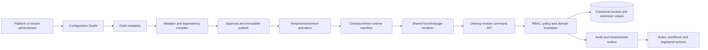

# Universal Configuration Studio and module production rollout

Date: 2026-09-12  
Planning work item: [WI-OI-039](../../.pi/work/WI-OI-039.md)  
Related architecture: [ADR-0002](../architecture/ADR-0002-governed-metadata-configuration.md)  
Status: implementation and certification plan; no production certification or release authorization

## 1. Decision

GigaLibs will use one governed Configuration Studio across the suite. Modules keep ownership of their
canonical records, transactions, state machines and financial or operational invariants. The Studio
configures only registered extension points: fields, settings, layouts, views, templates, mappings,
bounded rules, workflows and tenant-defined non-core applications.

The delivery order is authority first, metadata/runtime second, a low-risk reference adopter third, AR as
the first financial adopter fourth, and then one complete module at a time. Visibility in navigation is not
an unlock. A module is unlocked for UAT only when an authorized user can complete its accepted business
journey through real APIs and PostgreSQL, including failure and recovery. Production release additionally
requires the full G5-G6 evidence and named human approvals.

## 2. Current-state interpretation

The current application exposes approximately 29 top-level module cards and many sub-routes. Their presence
does not establish one production application. The readiness audit found a mixture of real partial services,
incompatible suite bridges, local in-memory stores, fabricated results, contained routes and modules whose
end business outcome has not been implemented.

Historical `verified live` text in `.pi/WORK_ITEMS.md` is explicitly qualified by the 2026-09-09 readiness
audit and must not be treated as current production certification. WI-OI-013 remains the active authority
repair. WI-OI-039 and ADR-0002 remain Proposed. Existing form packages and the `form_schemas` tables are
source inventory; they do not yet constitute the universal runtime described here.

## 3. Honest module states

The UI and release evidence use these states consistently:

| State | Meaning | What users can do |
| --- | --- | --- |
| Inventory | Code, route or package exists; owner/outcome may be unresolved | Nothing is promised |
| Contained | Screen may be inspected, but business actions are blocked | Review intended scope only |
| Actionable UAT | Accepted journey uses real isolated data, API and PostgreSQL; role and failure tests pass | Perform the documented UAT journey |
| Production candidate | Module DoD, integration, recovery, security, accessibility, performance and operational evidence pass | Release authority may evaluate it |
| Released | Named humans authorize a controlled cohort and production observation succeeds | Licensed tenants use the capability |

Badges such as `AVAILABLE`, `REVIEW` or `UAT` must be derived from evidence and activation records. They
cannot be hardcoded independently in the sidebar and module catalogue.

## 4. Target architecture



The implementation consists of the following code-owned platform capabilities:

| Capability | Production responsibility |
| --- | --- |
| Module registry | Stable module key, owner, routes, dependencies, health, entitlement key and accepted outcome |
| Extension-point registry | Declares which entities, settings, layouts, events and actions a module allows administrators to configure |
| Entity and field registry | Typed fields, relationships, constraints, classification, search policy and immutable keys |
| Component registry | Allowlisted accessible display/editor components with version compatibility |
| Schema/version service | Draft, validate, diff, approve, publish, deprecate and retrieve immutable definitions |
| Scope resolver | Platform -> plan -> tenant -> business unit -> customer -> authorized transaction override |
| Layout/view service | Forms, pages, sections, lists, filters and role/device/locale variants |
| Configuration compiler | Rejects cycles, unknown components, unsafe expressions, weakened constraints and missing dependencies |
| Runtime renderer | Renders published manifests with loading, empty, denied, error and stale-version states |
| Module adapter SDK | Runs module commands, validates extension values and writes snapshots without generic table mutation |
| Tenant application store | Supports accepted non-core custom entities; cannot replace invoice, payment, asset or other canonical owners |
| Policy/workflow bridge | Composes typed facts and registered actions; excludes arbitrary SQL, JavaScript, shell and unrestricted HTTP |
| Package/ALM service | Moves definitions and environment references across dev/UAT/staging; never moves customer data or secrets |
| Activation/operations plane | Cohort activation, last-good pinning, health, audit, metrics, traces and cache invalidation |

### 4.1 Persistence boundary

Core tenant, identity, money, status, tax, payment, invoice, asset and work-order facts remain typed relational
columns. Approved extension values use typed JSONB with a schema version and checksum on the owning record or
in an associated extension table. Searchable fields enter a governed projection/index registry. A custom
field never creates uncontrolled per-tenant DDL.

Minimum metadata records are:

- module, entity, extension-point, field and component definitions;
- immutable schema, layout, view, template, policy and workflow versions;
- tenant overlays, dependencies, approval and activation records;
- extension values with owning record, tenant, schema version, checksum and optimistic version;
- projection/index registrations and rebuild checkpoints;
- configuration audit and transactional outbox events.

### 4.2 Zero-code boundary

Administrators can create fields, forms, tables, dashboards from registered widgets, views, mappings,
templates, bounded validation, approval flows and tenant-defined non-core record applications. Reviewed code
remains required for new authentication semantics, financial arithmetic, tax/accounting invariants, payment
allocation, external protocols, provider actions, cryptography, retention, high-volume workers and new complex
components.

### 4.3 AI-assisted authoring boundary

AI is an optional design-time assistant. It is not part of the runtime rendering, validation, persistence or
authorization path. The complete Studio must remain usable when no model provider is configured or the
provider is unavailable.

An AI request may produce only a draft `ConfigurationChangeProposal` against the caller's authorized
registry context. It cannot publish, activate, run migrations, generate executable React/JavaScript/SQL,
register an external URL, create a permission, weaken a locked constraint or mutate a business record. The
proposal passes through the same deterministic compiler, diff, preview, approval and publish lifecycle as a
human-authored change.

The AI boundary requires:

- allowlisted input assembled by the server from entity, surface, component, field and permission registries;
- customer values excluded by default and classified/redacted before any approved provider call;
- structured JSON output validated against a versioned proposal schema, with all unknown keys rejected;
- prompt-template version, model/provider identifier, input-context checksum, output checksum, actor and
  disposition retained without secrets or unapproved personal/business data;
- prompt-injection and hostile-description tests proving text cannot escape the proposal schema;
- cost, timeout, retry and rate limits, plus explicit unavailable/abstained states;
- mandatory human approval for every proposed schema, layout, validation or activation change;
- no runtime dependency on the AI transcript: published checksummed metadata is the only renderer input.

This makes prompts a productivity feature rather than a second, ungoverned application-development path.

### 4.4 Existing dynamic-form convergence decision

`@gigalibs/form-engine-core` is source inventory, not the production core. It currently mixes useful field
concepts with unsafe or misplaced responsibilities: unrestricted integration flags/URLs, `any` values,
dynamically constructed JavaScript formula evaluation and runtime SQL/DDL generation. Its certification
test cannot establish tenant, API, database, publication or module-adapter behavior.

The convergence disposition is:

| Existing capability | Disposition | Production replacement |
| --- | --- | --- |
| Field-type vocabulary | Retain after contract review | Versioned field and component registries with stable keys |
| Required/range/length/pattern validation | Retain semantics, rewrite implementation | JSON-Schema-compatible structural validation plus bounded rule AST |
| Conditional visibility | Retain after cycle/type checks | Compiler-produced expression AST evaluated identically on server and client |
| Calculated formula using `Function(...)` | Remove | Parsed arithmetic/decision DSL with allowlisted operators, types, depth and execution budget |
| `Record<string, any>` values | Remove | JSON value union plus field-type-specific schemas and canonical serialization |
| Tenant identifier in submitted schema | Remove as authority | Tenant derived from verified session; scope stored by trusted service |
| Arbitrary webhook/Slack/provider flags | Remove | References to registered actions/connections with permissions, idempotency and receipts |
| Per-form PostgreSQL DDL generation | Remove | Forward-reviewed shared migrations and a governed projection/index registry |
| Form and submission lifecycle | Split | Configuration service owns definitions; each module owns its business records and extensions |
| Standalone form submission | Retain only for bounded custom applications | Tenant application store with RBAC, audit, retention, export and deletion |

No old forms package enters the production dependency graph until this disposition is implemented and its
consumers use the canonical contracts. Duplicate `forms-engine*`, `form-engine*` and `custom-fields*`
packages must be consolidated or quarantined; they cannot become competing metadata owners.

### 4.5 Code ownership and deployment topology

Configuration Studio is a control-plane capability, not another independent business-data microservice.
The initial production topology is:

| Location | Ownership |
| --- | --- |
| `packages/contracts` | Language-neutral configuration, manifest, adapter and event contracts |
| `packages/db` | Configuration metadata models and forward migrations |
| `packages/configuration-core` | Pure compiler, compatibility classification, checksums and bounded expression evaluator |
| `packages/configuration-nest` | Tenant-scoped authoring, approval, publish, activation and runtime-manifest services |
| `packages/configuration-react` | Accessible field/form/list/detail/page renderer and preview components |
| `apps/playground-api` | Mounts the canonical Nest control-plane endpoints and transactional services |
| `apps/workflow-platform/app/(app)/configuration-studio` | Platform/tenant administrator authoring UI |
| Owning module APIs | Validate and atomically persist canonical plus extension values through module adapters |

The package names above are target ownership boundaries. Create them only after the duplicate-package
disposition and API contracts pass review. Configuration metadata uses the control-plane database;
business extension values remain with the owning module so the Studio never becomes a universal business
table gateway.

### 4.6 Trust-boundary rule

There are two separate command paths:

```text
Authoring: Studio UI -> configuration API -> compiler -> approval -> immutable publish -> activation
Business:  module UI -> module API -> module invariant + manifest validation -> module transaction
```

The Configuration API must not expose `POST /tables/:name`, generic SQL, arbitrary entity mutation or a
generic write-through endpoint to canonical business tables. A renderer is presentation; it never grants
record authority. The owning module derives tenant/user context, checks object and field permissions,
re-resolves or verifies the pinned manifest, validates values, applies domain rules and commits the record,
extension values, audit and outbox together.

## 5. Phase plan

Only one domain module enters Build at a time. Platform-core work is allowed only when it is a prerequisite
of that selected vertical slice and is traced to the same accepted outcome.

### Phase 0 - Runtime truth and containment

**Purpose:** establish a trustworthy baseline before adding capabilities.

Implementation:

1. Inventory every route, menu entry, API, package, database owner, queue, scheduled worker and external provider.
2. Assign one canonical owner and one business outcome to every module and submodule.
3. Remove production reachability for static stores, fabricated results, silent fixture fallbacks and fake provider states.
4. Reconcile the sidebar, module catalogue, entitlements and runtime deployment manifest into one module registry.
5. Record missing, empty, loading, denied, conflict and provider-failure behavior for every actionable screen.

Exit evidence:

- production-data, all-runtime-data, package-dependency, API-boundary, navigation and SDLC audits pass;
- every visible badge matches evidence-backed readiness and activation;
- every contained action fails closed and makes no business mutation;
- the module inventory has no ownerless API or duplicate system of record.

**Modules unlocked:** none. This phase makes the application honest.

### Phase 1 - Identity, tenant and commercial authority

**Purpose:** establish who can administer the platform, who belongs to a tenant and which capabilities a tenant owns.

Implementation:

1. Complete platform-user, tenant, membership and role lifecycles, including invitation, activation,
   suspension, revocation, password recovery, MFA and external identity deprovisioning.
2. Enforce platform roles separately from tenant roles and object permissions at every server command.
3. Complete tenant creation, slug/custom-domain verification, environment and regional data binding.
4. Implement plan catalogue, trial start/expiry, entitlements, limits, extensions, payment conversion and suspension grace states.
5. Implement support access and `Preview as tenant/user` with explicit reason, time limit and audit.
6. Verify PostgreSQL 16 clean migration, backup, restore and restart behavior.

Exit evidence:

- two-tenant isolation and cross-tenant denial pass across UI, BFF, API, jobs and exports;
- all supported platform and tenant roles complete positive and negative journeys;
- revocation takes effect in active sessions and external identities;
- trial expiry and plan changes change entitlements without deleting tenant records;
- local OIDC plus the selected external OIDC/SAML/WebAuthn scope pass their accepted interoperability tests;
- independent Security, QA and Product reviewers sign the authority packet.

**Modules unlocked:** Platform Control Tower, Platform Users & RBAC, Tenant RBAC & Settings and Personal Security.

### Phase 2 - Configuration Studio foundation

**Purpose:** implement the universal governed metadata runtime before modules create another static form stack.

Implementation slices:

1. **CS-01 registry contracts:** accept ADR-0002 and define module, entity, surface, field, component,
   classification, permission, version, dependency and adapter contracts.
2. **CS-02 metadata persistence:** forward migrations for definitions, drafts, versions, overlays,
   dependencies, approvals, activations, extension values, indexes, audit and outbox.
3. **CS-03 authoring API:** tenant-scoped change-set, validation, review, publication, activation, impact and
   runtime-manifest endpoints with concurrency and idempotency controls.
4. **CS-04 compiler:** deterministic validation, compatibility classes, safe expression grammar,
   checksummed manifests, dependency graph and stale-client conflict behavior.
5. **CS-05 activation runtime:** scoped activation, last-good version, cache/event invalidation and drift
   health across replicas.
6. **CS-06 Studio UI:** field, settings, form, list and page designers with diff, impact preview, approval,
   publish, deprecate and activation history.
7. **CS-07 React renderer:** accessible create/edit/read/list rendering, complete UI states and field-level
   read/write/mask/export policy.
8. **CS-08 reference adapter:** tenant/customer profile extension through its owning API, real PostgreSQL,
   audit, export/erase and restart journeys.
9. **CS-09 ALM and operations:** signed configuration packages, environment parameters, drift detection,
   monitoring and dev -> UAT -> staging promotion.

Exit evidence:

- unauthorized, malformed, cyclic, oversized and incompatible definitions fail closed;
- published manifests are immutable and stable across process/database restart;
- tenant overlays cannot weaken locked module rules or grant permissions;
- accessibility, localization, optimistic conflict, rollback/forward-fix, cache and restoration journeys pass;
- package promotion moves no business data or secrets.

**Modules unlocked:** Configuration Studio administration only. No financial module is certified by this phase.

#### Phase 2 executable work packets

| Packet | Build result | Required exit test |
| --- | --- | --- |
| CS-01 Registry contracts | Stable module/entity/surface/component/field/action keys, classifications and compatibility policy | Invalid, unknown, reserved and duplicate keys rejected; contracts compile for TypeScript and portable JSON Schema |
| CS-02 Metadata migration | Definitions, drafts, immutable versions, overlays, dependencies, approvals, activations, audit/outbox and projection registry | PostgreSQL 16 clean/upgrade/restore; two-tenant isolation; immutable version constraints |
| CS-03 Authoring API | Create/edit/diff/validate/submit/approve/reject/publish/deprecate endpoints with optimistic concurrency | Role negatives, stale `If-Match`, replay/idempotency, last-approver and separation-of-duties tests |
| CS-04 Compiler | Deterministic resolved manifests, dependency graph, compatibility class, checksums and bounded expressions | Same input produces same checksum; cycles, depth/size abuse, unsafe expressions and weakened locks fail closed |
| CS-05 Activation runtime | Scoped activation, cohort targeting, last-good pin, cache invalidation and drift health | Restart consistency, stale-client conflict, rollback and multi-replica invalidation |
| CS-06 Studio UI | Entity/surface chooser, field builder, layout designer, validation builder, diff, preview, approval and activation history | Platform-admin and tenant-admin journeys; keyboard, focus, screen reader, locale and small-screen tests |
| CS-07 React renderer | Manifest-driven create/edit/read/list rendering with complete states and field security | Client and server validation parity; hidden/masked/readonly/write-only cases; unknown component fails closed |
| CS-08 Reference adapter | Tenant/customer profile extension persisted with schema version/checksum | Browser -> API -> PostgreSQL -> refresh -> restart -> export/erase and two-tenant proof |
| CS-09 ALM/operations | Signed configuration package, environment parameters, drift detection, metrics, alerts and runbook | Dev -> UAT -> staging promotion moves no records/secrets; failed activation returns to last-good version |
| CS-AI-01 Optional copilot | Natural-language request produces a draft proposal only | Provider outage leaves Studio usable; hostile prompts cannot publish, activate, expose data or produce executable code |

CS-AI-01 starts only after CS-01 through CS-08 pass without AI. AI cannot be used to hide missing registry,
compiler, renderer or module-adapter work.

### Phase 3 - Reference adoption and custom application builder

**Purpose:** prove zero-code changes on low-risk data before financial adoption.

Implementation:

1. Register tenant profile and customer profile as the first extension entities.
2. Allow fields, sections, list columns, visibility, classification, masking and permitted settings overrides.
3. Add a tenant-defined non-core entity store with forms, list/detail pages, relationships, saved views and audit.
4. Add module/page navigation publishing, role permission and plan/tenant targeting.
5. Add Preview as tenant/user and isolated UAT records clearly excluded from value reporting.
6. Prove rename, deprecation, compatible addition, search projection rebuild and rollback.

Exit evidence:

- two tenants publish different profile fields without data leakage;
- browser -> API -> PostgreSQL -> refresh -> restart -> export/erase lifecycle passes;
- platform-locked constraints survive every tenant overlay;
- a custom non-core application can be authored and published without arbitrary code or generic canonical-table access.

**Modules unlocked:** Tenant/Customer Settings extensions, Dynamic Forms and bounded custom pages/modules.

### Phase 4 - Finance foundation and Accounts Receivable

**Purpose:** prove Configuration Studio against real financial records and deliver the first complete finance outcome.

#### 4A. Tax and currency dependencies

- Tax owns supported jurisdictions, registrations, effective rates, exemptions, evidence and deterministic decisions.
- Currency owns ISO precision, approved rate sources, freshness, dated rates, conversion rounding and immutable conversion ledger.
- Missing/stale/unsupported configuration blocks the consuming financial action; it never silently produces zero tax or an invented rate.

#### 4B. AR business outcome

Implement customer billing profiles, source/manual billable records, pricing/markup, draft/edit/version,
tax/currency calculation, approvals, numbering, immutable issuance, rendered-document snapshot, delivery,
payments and allocation, balances/aging, credit notes, void/rebill, supplemental invoice families, missed-billing
control, accounting mapping and reconciliation.

Configuration Studio supplies optional customer/source/invoice fields, layouts, views, templates, numbering
tokens, approved policy parameters and mappings. Quantity, money, currency, tax basis, ledger state and invoice
state transitions remain typed code-owned facts. Issuance snapshots every extension, template, policy, rate
and source version used.

Exit evidence:

- manual and source-backed customer-to-cash journeys pass with real isolated PostgreSQL data;
- the `26 approved now, 4 later` supplemental scenario passes without duplicate or missed billing;
- issue/delivery/payment/credit/void uncertainty and reconciliation paths pass;
- customer, role, currency, tax and concurrency boundaries pass;
- generated documents reproduce the persisted issued snapshot;
- finance/domain, security, QA and product independently review the result.

**Modules unlocked in order:** Tax Configuration -> Multi-Currency FX -> Accounts Receivable.

### Phase 5 - Spend, AP and finance recovery

**Purpose:** complete procure-to-pay and evidence-backed recovery after common finance contracts exist.

Implementation order:

1. Spend Management: budgets, expenses, policies, approvals, supplier/payment intent and reconciliation.
2. 3-Way Match: documents, purchase order, receipt, invoice match, tolerances, exceptions and approval/action.
3. Autonomous Recovery: real detectors over authoritative finance facts, supervised action, receipt and recovered-value reconciliation.

Configuration Studio supplies intake fields, coding dimensions, approval layouts, matching-policy parameters,
exception views and supervised playbooks. Payment execution, match arithmetic, ledger effects and recovery
claims remain code-owned.

Exit evidence:

- approved expense reaches a real accepted disbursement provider/sandbox and reconciles;
- match exceptions prove invoice/PO/receipt lineage and cannot bypass approval;
- recovery value is recorded only after an external or ledger receipt reconciles;
- retry and replay do not create duplicate financial effects.

**Modules unlocked:** Spend Management & AP -> 3-Way Match Invoices -> Autonomous Recovery Studio.

### Phase 6 - Connections, data contracts and ontology

**Purpose:** provide trustworthy industry-neutral source ingestion for Event, Manufacturing, Logistics,
Construction and other external components.

Implementation order:

1. Credentials and secrets references with rotation and least-privilege scopes.
2. Connector instances, authorization, schedules, webhooks, checkpoints, limits and health.
3. Versioned data contracts, mappings, validation, drift detection, quarantine and replay.
4. Canonical identity/reference resolution and source lineage.
5. Operational ontology only where accepted owners and record semantics exist.

Exit evidence:

- at least one real approved provider/sandbox delivers attributable records exactly once to an accepted consumer;
- revoke, timeout, rate-limit, malformed data, schema drift, replay and reconciliation pass;
- connection health derives from actual consent and provider interaction;
- every canonical record drills back to the source version and transformation.

**Modules unlocked:** Connections & Adapters -> OAuth Studio/Credentials -> Data Contracts -> Operational Ontology.

### Phase 7 - Rules, workflow, saga and action operations

**Purpose:** turn registered facts into durable governed action without manufactured step results.

Implementation order:

1. Rules: typed facts, effective versions, deterministic hit policy and human-readable reasons.
2. Workflow: pinned graph versions, triggers, waits, parallel branches, approvals and registered actions.
3. Saga: durable checkpoints, compensation, retry, cancellation and uncertain-result handling.
4. Approval, runs and exceptions: operational views over the same execution records.
5. Dead-letter operations: safe inspect, repair, replay and permanent disposition.

Exit evidence:

- no arbitrary SQL/JavaScript/HTTP or unregistered action can be published;
- restart/replay/cancel/compensate preserves exactly-once business-effect semantics;
- every approval and action records actor, policy, intent, idempotency key, receipt and reconciliation;
- run, exception and DLQ views reflect one authoritative execution state.

**Modules unlocked:** Universal Rules -> Workflow Studio -> Saga Orchestrator -> Execution Runs -> Approval Queue -> Exceptions & Quarantine -> DLQ.

### Phase 8 - Physical operations and documents

**Purpose:** complete asset/service outcomes and their evidence sources after identity, configuration and
orchestration are reusable.

Implementation order:

1. CMMS asset registry and hierarchy.
2. Service request, work order, assignment, labor/parts, checklist, downtime and restoration.
3. Preventive schedules, meters/telemetry, inventory, procurement, people and vendors.
4. Document intake/OCR review with authorized storage and immutable lineage.
5. E-signature with provider consent, signer identity, evidence package and reconciliation.
6. Geospatial views over canonical authorized locations and assets.

Configuration Studio supplies asset-type fields, inspection forms, checklists, work-order layouts,
service-request portals and document review fields. Inventory valuation, work-order lifecycle, telemetry
ingestion and signature validity remain code-owned.

Exit evidence:

- request -> triage -> work -> resource use -> evidence -> restored asset passes;
- preventive and meter triggers produce the correct non-duplicated work;
- files have authorization, classification, malware handling, retention and immutable lineage;
- signature/provider failures and location data absence are represented honestly.

**Modules unlocked:** CMMS/EAM and submodules -> Document Scanner -> E-Signature -> Geospatial Studio.

### Phase 9 - Intelligence, commercial control and solution packaging

**Purpose:** expose metrics and packages only after source modules emit verified outcome facts.

Implementation order:

1. Reports and Analytics over registered fields, authorized projections and drill-through lineage.
2. Business Value Ledger over reconciled source outcomes, excluding test/demo records.
3. Metering over runs, providers, storage and registered module usage.
4. Marketplace installation with dependency, entitlement, compatibility and rollback checks.
5. Solution Packs as immutable configuration/module packages with accepted industry outcomes.
6. Infrastructure Broker only for approved provisionable resources with credentials, cleanup and cost controls.

Exit evidence:

- every metric drills into current, tenant-authorized source records;
- exports enforce field classification and authorization;
- usage reconciles to customer billing and plan limits;
- install/upgrade/uninstall and rollback preserve tenant data and dependencies;
- packages contain definitions, never secrets, fabricated records or customer data.

**Modules unlocked:** Reports -> Analytics Studio -> Business Value Ledger -> Metering -> Marketplace -> Solution Packs -> Broker Infrastructure.

### Phase 10 - Integrated production certification and release

**Purpose:** prove the selected release cohort as one operable SaaS system.

Required evidence:

1. Clean install and upgrade migrations, PostgreSQL 16 backup/restore and regional binding rehearsal.
2. Full role/tenant/plan/trial/custom-domain browser journeys.
3. Accessibility WCAG 2.2 AA and first-time-user usability.
4. Representative load, concurrency, noisy-neighbor, provider fault and recovery tests.
5. Distributed traces, SLOs, alerts, dashboards, runbooks and on-call rehearsal.
6. Secret, SAST, dependency, container, IaC, SBOM and provenance gates.
7. Retention, export, erasure, legal hold and audit verification.
8. Independent Security, QA, Architecture, Domain and Product decisions.
9. Cohort deployment with explicit rollback/forward-fix criteria and production observation.

Only the modules whose individual packets pass are released. An incomplete module remains contained; it does
not delay truthful release of an independently complete module unless it is a declared dependency.

## 6. Module-level unlock matrix

| Module | Minimum accepted business outcome before Actionable UAT | Configuration Studio adoption | Hard dependency |
| --- | --- | --- | --- |
| Platform Control Tower | Create/suspend/reactivate tenant; manage plan, region, domain and entitlements | Tenant fields, branding and allowed policy parameters | Phase 1 authority |
| Platform Users & RBAC | Create/invite/link/suspend/revoke platform users and roles with audit | Profile fields and bounded role views | Identity provider and audit |
| Tenant RBAC & Settings | Invite user, assign tenant role, enforce permission, revoke and recover | Tenant/customer settings and layouts | Platform/tenant separation |
| Personal Security | Update profile/password, enroll/recover MFA, manage identities/sessions | Low-risk profile fields | Verified identity |
| Dynamic Forms / Configuration Studio | Draft, preview, approve, publish, activate and roll back a schema/layout | It is the shared core | Phases 1-3 |
| Tax Configuration | Maintain supported effective registrations/rates/exemptions and return attributable decisions | Evidence fields, layouts and allowed parameters | Customer/item/address facts |
| Multi-Currency FX | Maintain approved rates and produce reproducible conversion ledger | Presentation and freshness parameters | Real rate source |
| Accounts Receivable | Customer-to-cash including supplemental, credit, void/rebill, payment and aging | Customer/source/invoice fields, templates, rules and views | Tax/currency plus Config Studio |
| Spend Management | Budget-to-approved expense-to-reconciled disbursement | Coding fields, approval layouts and limits | Provider/action foundation |
| 3-Way Match | PO/receipt/invoice matching through exception and governed action | Intake fields, tolerance parameters and views | Spend, documents, workflow |
| Autonomous Recovery | Detect evidenced leakage, approve intervention and reconcile recovered value | Detector parameters and playbooks | Real finance sources/actions |
| Connections & OAuth | Authorize, ingest/sync, monitor, revoke and reconcile a real provider | Instance properties and mappings | Secrets and selected consumer |
| Data Contracts | Version, validate, map, quarantine and replay a real source payload | Contract/mapping authoring | Connector source envelope |
| Operational Ontology | Resolve accepted canonical identities and relationships with lineage | Labels, relationship views and mapping | Domain owners/data contracts |
| Universal Rules | Execute the intended effective policy with deterministic reason | Bounded expressions and decision tables | Typed facts |
| Workflow Studio | Publish and execute recoverable version-pinned workflow | Registered nodes/forms/routes | Rules/events/actions |
| Saga Orchestrator | Resume/compensate a distributed business process without duplicate effect | Registered compensation policies | Durable workflows/adapters |
| Execution Runs | Operate real run state, steps, retry and correlation | Saved operational views | Workflow runtime |
| Approval Queue | Authorize/reject a real governed action with separation of duties | Approval routes and layouts | Action gateway |
| Exceptions & Quarantine | Assign, repair, retry or resolve a real exception with audit | Queues, escalation and views | Producing modules |
| Dead Letter Queue | Inspect, repair, replay or dispose failed messages safely | Retention and operational views | Event/outbox infrastructure |
| CMMS/EAM | Request-to-restoration with assets, labor, parts, downtime and evidence | Asset fields, forms, checklists and layouts | Config, workflow, inventory owners |
| Document Scanner | Ingest, extract, review and hand off an authorized document with lineage | Review fields and mappings | Storage/provider/security |
| E-Signature | Send, sign, verify and reconcile an evidence package | Template and routing parameters | Identity/provider/action gateway |
| Geospatial Studio | Render and act on authorized canonical locations without invented data | Layers, property panels and views | Canonical spatial facts |
| Reports | Build authorized persisted reports with lineage and controlled exports | Columns, filters, schedules | Registered read models |
| Analytics Studio | Produce attributable metrics and drill-through analysis | Measures, dimensions and dashboards | Source outcome facts |
| Business Value Ledger | Record verified realized value with source evidence and reversals | Outcome presentation and thresholds | Reconciled domain outcomes |
| Platform Metering | Meter, limit, forecast and reconcile billable platform usage | Plan/alert parameters | Stable meters and tenant plans |
| Module Marketplace | Install/upgrade/disable modules with dependencies and data-safe rollback | Package/entitlement selection | Config ALM and metering |
| Solution Packs | Deploy immutable reusable configurations for accepted outcomes | Package composition | Certified component modules |
| Broker Infrastructure | Provision/reconcile/clean approved infrastructure resources | Instance parameters and quotas | Secrets, observability and cost controls |

## 7. Standard implementation template for every module

Every module passes the following steps. None may be replaced with a UI-only unlock.

1. Accept actor, trigger, end result, exclusions, source of truth and measurable business outcome.
2. Assign canonical entity/API/table/event owners; quarantine duplicates.
3. Define permission matrix, data classification, tenant isolation and abuse/threat cases.
4. Define API/events, idempotency, concurrency, state machine, failure, retry, reconciliation and retention.
5. Add forward migration, compatibility analysis, clean replay and roll-forward/recovery plan.
6. Implement real persistence, command authorization, invariants, audit and transactional outbox.
7. Register only safe fields/settings/layouts/events/actions with Configuration Studio.
8. Build the suite UI with complete loading, empty, denied, validation, error, conflict and recovery states.
9. Run unit tests for invariants, API/DB integration, two-tenant/RBAC negatives, restart/replay, browser UAT,
   accessibility, performance and operational verification.
10. Assemble requirement -> design -> code/migration -> test -> release evidence -> metric traceability.
11. Obtain independent domain, architecture, security, QA and product decisions.
12. Activate an isolated cohort, observe SLO/business metrics and retain last-good/forward-fix procedures.

## 8. Immediate execution backlog

The next executable sequence is:

1. Close WI-OI-013 authority gaps and independent acceptance; do not bypass them for local UAT.
2. Complete WI-OI-036 runtime/data-truth inventory and remove or contain remaining local stores and fabricated results.
3. Move ADR-0002 and WI-OI-039 through G1-G3 review with accepted CS-01 contracts.
4. Build CS-02 through CS-05 as the sole active implementation stream.
5. Build CS-06 through CS-08 and certify the tenant/customer profile extension as the reference adopter.
6. Build CS-09, add the bounded custom page/module builder and prove promotion/publication/rollback.
7. Adopt AR draft/customer extensions and immutable issue snapshots.
8. Finish Tax -> Currency -> full AR outcomes before claiming Finance unlocked.
9. Continue the module sequence in this plan, one complete vertical slice at a time.
10. Schedule CS-AI-01 only after CS-01 through CS-08 pass independently; AI is never an unlock dependency.

The local environment may bypass external DNS routing or use authorized provider sandboxes where a production
provider is unavailable. It may not bypass authentication, tenant isolation, permissions, persistence,
idempotency, audit, failure handling, migration safety or reconciliation. Evidence records must be visibly
test-attributable and excluded from customer value reporting.

## 9. Canonical persistence model

The first forward migration should implement these logical records. Exact physical names are finalized in
the migration ADR, but their ownership and constraints are mandatory.

| Record | Required fields and constraints |
| --- | --- |
| Configuration entity | stable key, module owner, canonical service/table owner, extendable operations, locked invariants |
| Extension surface | stable key, entity key, route/slot, supported modes, component compatibility, permissions |
| Component definition | stable type/version, value schema, property schema, renderer version range, accessibility contract |
| Field definition | immutable key, type, classification, constraints, search/export/aggregate policy, lifecycle state |
| Change set | tenant/environment scope, base version, actor, reason, optimistic version, lifecycle state |
| Draft document | typed schema/layout/view/template/rule content, validation result and content checksum |
| Published version | immutable sequence, checksum, compatibility class, publisher/approver evidence and timestamp |
| Dependency | consumer version, provider key/version range, required/optional and activation order |
| Activation | scope, published version, cohort, status, activated/rolled-back actor and last-good reference |
| Extension value | tenant, owning entity/record, schema version/checksum, typed JSONB, optimistic version and timestamps |
| Field projection | field/version, approved index/search/report target, build checkpoint and health |
| Audit/outbox | actor, tenant, correlation, command, before/after checksums, outcome and post-commit delivery state |

Published versions are append-only. Activation changes the selected version; it never edits a published
document. Extension rows have a unique tenant/entity/record boundary and a foreign-key or verified owner
reference appropriate to the owning module. Secrets are references to the approved credential store and
never appear in definitions, manifests, previews, packages or audit payloads.

## 10. Canonical APIs

The API contract should expose business-specific configuration operations rather than generic storage:

| API family | Commands/queries |
| --- | --- |
| Registry | list modules, entities, surfaces, component versions, permissions and locked constraints |
| Change sets | create, retrieve, edit with `If-Match`, abandon and compare |
| Validation | compile draft, return field/dependency/security/compatibility findings and manifest preview |
| Review | submit, approve, reject and record independent-review evidence |
| Publish | publish immutable version with idempotency key and content checksum |
| Activation | plan, activate cohort, inspect health, roll back to last-good and deprecate |
| Runtime | retrieve resolved manifest by tenant/scope/surface with ETag and checksum |
| Impact | locate consuming surfaces, active records/versions, projections, packages and blocked dependencies |
| ALM | export/import signed metadata package, bind environment references and compare drift |
| AI proposals | request/cancel/read draft proposal; accept selected changes into a human-owned change set |

Every mutation requires authenticated server-derived tenant scope, permission, reason, correlation ID,
idempotency where replay is possible, optimistic version and audit outcome. Runtime manifest responses are
cacheable only by tenant, scope, locale, role/field policy and activation checksum.

## 11. Studio UI implementation order

Build the UI vertically so every screen uses real APIs from its first merge:

1. **Catalogue:** modules -> entities -> registered surfaces, with owner, status and locked-invariant disclosure.
2. **Field editor:** stable key, label/help, type, required/constraints, classification, permissions,
   search/export policy and lifecycle; no drag/drop yet.
3. **Layout editor:** sections, columns, tabs and allowlisted components; keyboard controls are first-class.
4. **Validation editor:** declarative conditions and cross-field rules using the bounded AST with readable
   test cases and server-generated explanations.
5. **Preview:** create/edit/read/list modes by role, locale, breakpoint and tenant overlay using visibly
   isolated preview values.
6. **Diff and impact:** compatible/incompatible changes, affected surfaces/records/projections/packages and
   required migration or new-field decision.
7. **Review/publish:** separation of duties, reason, approval evidence, immutable version and checksum.
8. **Activation/operations:** environment/cohort activation, health, drift, cache status, last-good rollback
   and audit timeline.
9. **Custom application builder:** only after the reference adapter passes; bounded non-core entities,
   forms, list/detail pages, relationships, navigation and permissions.
10. **AI copilot:** natural-language-to-draft proposal after the manual Studio is complete and independently
    usable; proposal diff is always shown before acceptance.

The first end-to-end demonstration is deliberately simple: Tenant A adds an optional classified profile
field; Tenant B does not see it; refresh/restart/export/erase work; rollback hides it without destroying its
historical value. The second is AR `customer_po_reference`, including immutable invoice-issue snapshot.

## 12. Compatibility, migration and rollback policy

Changes are classified before publish:

- **compatible:** optional field, label/help/layout change, new choice where consumers allow unknown values;
- **conditionally compatible:** required field with default/backfill, tightened validation, projection/index
  change or permission reduction; activation waits for an approved migration/checkpoint;
- **breaking:** type change, field-key reuse, choice removal used by records, invariant relaxation,
  relationship target change or snapshot-semantics change; publish requires a new field/version and explicit
  consumer migration;
- **prohibited:** weakening authentication/tenant/financial invariants, arbitrary code/SQL/HTTP, secret
  embedding, cross-tenant lookup or mutation of an immutable issued record.

Rollback means activating a known compatible last-good manifest. It does not delete definitions or values,
rewrite records or reverse an unsafe business migration. Data/schema corrections use reviewed forward
migrations with checkpoints and recovery evidence. An issued invoice, completed signature or settled
financial record always renders from its pinned snapshot, even after current configuration rolls back.

## 13. Production certification matrix

| Concern | Minimum evidence before Production Candidate |
| --- | --- |
| Functional | Author, validate, preview, approve, publish, activate, use, deprecate and roll back real versions |
| Persistence | Clean/upgrade/restore on PostgreSQL 16; restart and multi-replica consistency |
| Tenancy/RBAC | Two-tenant positive/negative tests across definition, manifest, value, search, export, cache and audit |
| Field security | Hidden, masked, readonly, write, export and classification combinations enforced server-side |
| Compatibility | Addition, rename, deprecation, tightened rule, new type, projection rebuild and stale-client conflicts |
| Reliability | Concurrent edits/publishes, idempotent replay, cache/event loss, restart and last-good activation |
| Performance | Agreed manifest compilation, cold/warm render, validation, projection and high-field-count budgets |
| Accessibility | WCAG 2.2 AA automation plus keyboard, focus, screen-reader and zoom/manual review |
| Security | Threat model; parser/regex/expression resource limits; injection, XSS, SSRF, mass assignment and export tests |
| Operations | Metrics/traces/alerts, drift dashboard, failed activation runbook, backup/restore and on-call rehearsal |
| AI, if enabled | Data classification, provider contract, prompt-injection/redaction, timeout/cost, abstention and no-publish proof |
| Module adoption | Reference profile and AR snapshot journeys pass through owning APIs and real PostgreSQL |
| Governance | Requirement/design/code/migration/test/evidence/metric trace plus independent Architecture/Security/QA/Domain/Product decisions |

No production claim is allowed from a builder screenshot, saved JSON, generated JSX, passing package unit
test or successful preview. Production Candidate requires the complete chain from authorized configuration
change through a module-owned persisted record and recovery evidence.
