# Universal invoice dynamic fields and templates guide

Status: Architecture guidance before implementation; proposed under WI-OI-039 and WI-OI-040  
Date: 2026-09-10  
Decisions required: ADR-0002 acceptance and independent Architecture, Finance, Security, Data, QA and
Product review

## 1. Direction

The WhooCrew event scenario is a domain adapter and acceptance example for the universal invoice product.
It must not redefine the universal invoice entity as an event, worker or shift.

The correct architecture has four boundaries:

1. **Universal coded invoice kernel:** customer, billing entity, draft, line, issue, invoice family,
   allocation, correction, payment/delivery/accounting state, money and audit invariants.
2. **Domain/source adapters:** WhooCrew event/timesheet/payroll, milestone billing, subscriptions, expenses,
   equipment or another approved source translate their records into one versioned billable-source
   contract.
3. **Governed metadata configuration:** registered entities, optional extension fields, field sets, layouts,
   visibility, validation, classification and tenant/customer applicability.
4. **Versioned document templates:** customer-specific document layout and allowlisted merge fields,
   snapshotted when an invoice is issued.

This preserves a universal invoice outcome while allowing each tenant and customer to capture different
context without a product deployment.

## 2. What is universal and what stays domain-specific

| Universal invoice capability | WhooCrew adapter contribution | Must not enter the universal kernel |
| --- | --- | --- |
| `BillableSourceRecord` identity, version, approval, quantity, unit, raw-cost snapshot and lineage | Maps approved worker/shift and payroll calculation into the contract | `crewMember`, `timesheet`, `event stage`, WhooTime table names or payroll database joins |
| `WorkSource` grouping and customer association | Maps a WhooCrew event to a work source | Assumption that every invoice has an event |
| Original/supplement family and source allocations | Supplies later approved records | Hard-coded 26/4 counts or a fixed `SUB1` limit |
| Markup policy and immutable resolved calculation | Supplies role/category used for an applicable rule | Crew-role-specific columns or a universal 35% default |
| Customer/template/layout selection | Supplies event fields approved for display | WhooCrew-only template tokens in the base invoice schema |
| Correction/reconciliation case | Supplies later timesheet/payroll versions | Direct mutation of an issued invoice after payroll correction |

The core contract can therefore support an event, project, case, order, subscription period, milestone or
another accepted work source. Each new source type still needs a reviewed adapter because source identity,
approval and correction semantics are business behavior, not arbitrary form metadata.

## 3. Current repository design truth

GigaLibs does **not** currently have a production-ready universal EAV or dynamic-form system.

| Existing artifact | What exists | Why it is not the production design |
| --- | --- | --- |
| Prisma `FormSchema` / `FormSubmission` | Tenant-linked schema JSON and generic payload tables | No immutable schema versions, direct tenant on submission, activation, field permissions, module adapter, server lifecycle, snapshots or canonical service/controller |
| `packages/form-engine-core` | Field types, client-side conditions/validation, formula and DDL helpers | Uses broad `any`, runtime regex and generated `Function`; can generate per-form DDL; no persistence, authorization, version/publish or module transaction |
| `packages/form-engine-react` | Visual prototype | Showcase-only, initialized with named sample tenants/companies/submissions and in-memory success |
| `packages/forms-engine` | Small schema builder | In-memory builder with no production service or record persistence |
| `packages/custom-fields` | Types and in-memory manager | No package manifest, database owner, lifecycle, authorization, audit, schema version or module integration |
| Module screens | Mostly coded React inputs and layouts | A field/layout change generally requires development |
| Standalone AR | Typed customer, draft and invoice tables/API | No extension columns/table, schema snapshot, metadata manifest or dynamic renderer yet |

These artifacts are useful source inventory. They should be reconciled into WI-OI-039 contracts or remain
quarantined; connecting one prototype directly to AR would create a second, unsafe source of truth.

## 4. Use a hybrid metadata model, not classic EAV

A classic EAV table stores every value as `(entity, attribute, value)`. It makes type constraints, joins,
financial transactions, reporting and migrations difficult. A single global JSON document without
governed metadata has different but equally serious validation, access and indexing problems.

Use a hybrid:

- canonical business fields remain typed relational columns in their owning module;
- metadata definitions and versions are normalized relational records in the configuration plane;
- approved optional values are a bounded typed JSONB document in the owning module transaction;
- issued/immutable records retain a copy of the extension values and schema checksum;
- only explicitly searchable fields receive typed derived index projections;
- a commonly used or invariant field is promoted to a real typed column through a reviewed migration.

```mermaid
flowchart LR
    Admin[Authorized configuration admin] --> Draft[Draft schema/layout/template]
    Draft --> Compiler[Validate + diff + compile]
    Compiler --> Version[Immutable published version]
    Version --> Binding[Tenant/customer/screen binding]
    Binding --> Manifest[Resolved runtime manifest]
    Manifest --> Renderer[Shared registered components]
    Renderer --> Command[Owning module command]
    Command --> Validate[Server schema + RBAC + domain validation]
    Validate --> Record[(Typed record + JSONB extensions)]
    Record --> Snapshot[(Issued immutable snapshot)]
```



### 4.1 Configuration-plane records

| Record | Essential fields |
| --- | --- |
| `entity_definitions` | Stable key such as `ar.customer` or `ar.invoice_draft`, module owner, supported operations, extension limits and immutable transition |
| `field_definitions` | Immutable key, type, label keys, constraints, classification, component choices, permissions, default semantics and lifecycle |
| `schema_versions` | Entity, parent version, complete resolved field set, checksum, compatibility class, author/approver and published/effective time |
| `field_sets` | Reusable grouping of fields for a customer segment/use case so definitions are not copied per customer |
| `layout_versions` | Screen key, sections/tabs/order/width and component binding by stable field ID |
| `applicability_bindings` | Tenant, customer/customer segment, work-source type, operation/screen, role/locale/device predicates, priority and effective range |
| `component_definitions` | Code-owned component ID/version, accepted value type, properties, accessibility contract and renderer compatibility |
| `template_versions` | Immutable structured document layout, allowlisted field references, assets, disclosure policy, checksum and render-engine version |
| `template_bindings` | Customer, segment, document kind, locale, priority, default/allowed selection and effective range |
| `activations` | Tenant/environment/cohort, schema/layout/template versions, checksum, actor, reason, prior activation and status |
| `configuration_audit/outbox` | Actor, reason, diff, validation, approval, publish/activate result and delivery state |

### 4.2 Module-owned extension storage

Each adopting module stores its values, for example:

```text
ar_record_extensions
  tenant_id
  entity_key                 # ar.customer, ar.invoice_draft
  record_id
  schema_version_id
  schema_checksum
  values_jsonb               # bounded keys and typed JSON values
  record_version
  created_by / created_at
  updated_by / updated_at
  PRIMARY KEY (tenant_id, entity_key, record_id)
```

The table is in `gigalibs_ar`, participates in the same transaction as the customer/draft update and has
forced tenant RLS plus tenant-safe ownership constraints. It is not a central platform value table that can
mutate any module. The AR API reads/writes it only through registered AR commands.

Issued invoices store `extension_schema_version`, `extension_schema_checksum` and an immutable
`extension_snapshot`. They never depend on the current customer layout to reconstruct historical output.

### 4.3 Search and reporting

A blanket EAV query or unrestricted JSON search is not the reporting design. A field must declare
`searchable`, `sortable`, `filterable` or `aggregateable`, its classification and supported operator. An
asynchronous tenant-scoped projection can use typed columns such as text, decimal, date or reference. The
canonical extension document remains the source; projection lag is visible. Restricted fields cannot enter
search/export merely because they appear on a form.

## 5. Different clients, different fields

Do not create a new physical table, column or copied form for each client. Define a field once within the
tenant and bind it through reusable field sets and applicability.

Example:

| Configuration | Customer A | Customer B | Tenant default |
| --- | --- | --- | --- |
| Shared invoice fields | PO reference, service period | PO reference, service period | Enabled |
| `event_venue` field set | Enabled | Disabled | Disabled |
| `union_local_code` field set | Disabled | Enabled | Disabled |
| `customer_cost_center` | Required on future drafts | Optional | Hidden |
| Invoice document | Detailed event template v3 | Summary template v7 | Standard template v2 |
| Raw internal cost | Internal screen with permission | Internal screen with permission | Excluded from customer documents |

Manifest resolution is deterministic:

```text
platform locked baseline
→ AR module baseline version
→ tenant extension schema
→ reusable customer/segment field sets
→ operation/screen layout
→ role/locale/device presentation variant
```

Higher-specificity bindings may alter only properties declared overridable. They cannot remove required
core invoice fields, widen access, change stored types, affect money, or grant a permission.

Use this template-selection precedence:

```text
authorized selection during generation
→ customer default binding
→ customer-segment binding
→ tenant default template
→ visible configuration error
```

The selected template version and binding reason are stored on the draft and snapshotted on issue.

## 6. Adding a field to selected screens without development

This becomes possible only after the module has registered configurable surfaces and extension slots.
“Any screen” means any **registered** screen and operation; configuration cannot inject an unknown component
into arbitrary application code.

For AR, register surface keys such as:

- `ar.customer.create`, `ar.customer.edit`, `ar.customer.detail`, `ar.customer.list`;
- `ar.invoice_draft.create`, `ar.invoice_draft.review`, `ar.invoice.detail`;
- `ar.work_source.summary`, `ar.invoice_family.detail`;
- `ar.invoice.document` and `ar.invoice.export` as separate disclosure-controlled surfaces.

An administrator then:

1. selects a registered entity and creates an immutable field key;
2. chooses an allowlisted type/component, label, help, constraints and classification;
3. selects tenant-wide, customer, customer-segment or work-source applicability;
4. places the field in one or more registered screen layouts and document templates;
5. selects field read/write/mask/export permissions;
6. previews the resolved result using isolated preview data;
7. reviews the compatibility/data impact and any required future-record/backfill rule;
8. publishes an immutable version and activates it for an environment/cohort;
9. enters data through the rendered screen; the module API re-resolves and validates the manifest;
10. sees the value after refresh/restart and, if issued, in the pinned historical snapshot.

If a newly required field has existing records, activation must choose one of: future records only, an
approved default, an explicit backfill or blocked publication. The system must never make historical issued
invoices invalid because an administrator changed today's layout.

## 7. Component and design-system boundary

The existing UI packages provide coded buttons, cards, inputs, tables, drawers and status components, but
there is no certified metadata renderer binding them today. WI-OI-039 should add one code-owned registry:

| Value type | Example registered components | Stored value |
| --- | --- | --- |
| Short/long text | text input, textarea, read-only text | string with length/classification rules |
| Integer/scaled decimal | number input, read-only formatted value | integer or canonical decimal string; never browser float for money |
| Date/time | date picker, timezone timestamp | ISO date or UTC instant plus zone policy |
| Choice/reference | select, combobox, multi-select | stable option/reference IDs, not display labels |
| Boolean | checkbox, switch | boolean |
| File/address/location | registered picker/editor | authorized object/reference or bounded structured value |
| Repeating group | bounded table editor | typed array with row/size limits |

Administrators select registered components and safe properties. They cannot upload JavaScript, import a
React component, execute `Function`/`eval`, generate DDL, call arbitrary HTTP, store secrets, or make a
form expression issue/void/pay an invoice. A new component type or business action requires code, security,
accessibility and compatibility review; once registered, tenants can configure its approved instances.

## 8. Invoice templates

A template is not an arbitrary HTML editor. Store a structured layout or tightly sanitized markup with:

- page/section/table primitives and approved style tokens;
- references to canonical invoice fields and permitted extension field IDs;
- conditional presentation through a bounded typed expression AST;
- versioned logo/asset references from authorized object storage;
- locale, currency and date formatting policies;
- explicit internal-only/customer-visible classification;
- renderer version, checksum and deterministic PDF test output.

Template preview can use visibly marked isolated data. Issuance renders from committed invoice and extension
snapshots, persists document/template/render versions and a content hash, then stores the PDF in the
approved object store. Later template edits create a new version and cannot change an issued document.

## 9. What is configurable and what remains coded

| No developer after the core is delivered | Requires reviewed code/domain change |
| --- | --- |
| Add optional text/date/choice/reference fields within entity limits | New financial state or invoice lifecycle transition |
| Change labels, help, order, sections, tabs and approved component | Quantity, price, markup/tax arithmetic or rounding semantics |
| Show a field for selected customers/segments/roles | Tenant/RBAC semantics or permission escalation |
| Configure bounded validation and conditional visibility | Arbitrary JavaScript, SQL, HTTP or provider action |
| Select list columns, safe filters and exports | New source/provider adapter or reconciliation behavior |
| Create/publish customer document template versions | New PDF renderer primitive with security/accessibility impact |
| Bind a template and approved delivery policy | Sending through an unregistered external provider |
| Add non-financial invoice/customer context | Turning a custom value into a ledger, tax or accounting invariant |

## 10. Implementation sequence before event billing

1. Accept ADR-0002 and decide which current form/custom-field packages are retired, reused internally or
   quarantined. Do not promote the current prototypes.
2. Define DC-01 contracts for entities, fields, field sets, layouts, components, templates, bindings,
   activations, versions, permissions, compatibility and module adapters.
3. Implement metadata persistence, publish/activate lifecycle, audit/outbox, manifest compiler and caches.
4. Build the server validator plus accessible runtime renderer from the code-owned component registry.
5. Certify a low-risk tenant-profile reference entity across two tenants.
6. Add the AR adapter for `ar.customer` and `ar.invoice_draft`, module-owned extension storage and issued
   snapshots while keeping all money fields locked.
7. Add customer field-set/layout/template bindings and certify two customers with different fields and
   documents.
8. Introduce the universal `BillableSourceRecord` contract, then implement WhooCrew as the first domain
   adapter under WI-OI-040.
9. Run source, invoice-family, markup, rebilling, delivery/accounting and exact 26-then-4 acceptance evidence.

This sequence avoids encoding WhooCrew nouns in the invoice kernel and avoids building configurable forms
that still have nowhere authoritative to save values.

## 11. Required proof before claiming zero-code support

- Two tenants define fields with the same key without data/cache leakage.
- Two customers within one tenant resolve different field sets, layouts and template versions.
- Create, edit, detail, list, filter, export and PDF paths enforce the same field classification and RBAC.
- Forged hidden/read-only values are rejected by the API.
- Values persist across refresh, API restart, worker restart, upgrade and restore.
- A stale schema checksum conflicts rather than dropping or misinterpreting values.
- Rename changes the label; type change requires a new field and conversion plan; removal deprecates history.
- Required-field activation handles existing drafts deliberately and never invalidates issued invoices.
- Issued invoice values/template/PDF remain byte-stable after later configuration changes.
- Invalid/cyclic/oversized expressions, schemas, layouts and templates fail publication.
- Search projections rebuild idempotently, remain tenant-scoped and report freshness.
- Publish/activate rollback pins the last compatible version with complete audit evidence.
- No production bundle imports sample schema/submission data, dynamic DDL or generated-function evaluation.

Until this evidence exists, GigaLibs has an approved direction and prototypes, not a universal zero-code
forms capability.
