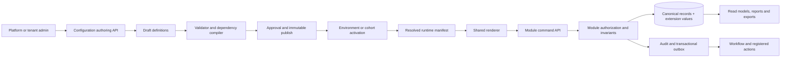

# GigaLibs governed configuration and module rollout plan

Date: 2026-09-09  
Architecture decision: [ADR-0002](../architecture/ADR-0002-governed-metadata-configuration.md)  
Planning work item: [WI-OI-039](../../.pi/work/WI-OI-039.md)  
Status: proposed G0–G3 implementation plan; not production certification or release authorization

## 1. Architectural direction

The right direction is **a stable coded core with governed zero-code configuration around it**. The goal is
to let platform and tenant administrators adapt supported fields, layouts, views, mappings and workflows
without waiting for a GigaLibs deployment, while the system continues to enforce tenant boundaries,
permissions, data truth, financial integrity and recoverable execution in code.

“Any field, component, model or logic can be changed without coding” is not a safe production target. A
useful enterprise target is:

| Change class | Delivery model | Examples |
| --- | --- | --- |
| Presentation | Zero-code after publish permission | label, help text, order, sections, tabs, list columns, saved views |
| Extension data | Zero-code within registered entity policy | optional text/date/choice/reference field, classification, conditional visibility |
| Bounded decision | Governed low-code | validation expression, approval route, mapping, formula from an allowlisted expression language |
| Process composition | Governed low-code | workflow made from registered events, decisions, waits and actions |
| Core business behavior | Reviewed code and migration | invoice totals, tax, RBAC semantics, payment allocation, work-order state machine |
| Integration/external effect | Reviewed adapter/action code; configurable instance | OAuth/provider adapter, payment/email/ERP write, retry/reconciliation behavior |

The platform should advertise “configure approved extensions without a product release,” with a documented
capability matrix per module. It should not advertise unrestricted zero-code development.

## 2. What major SaaS platform designs teach us

Official product documentation exposes platform patterns, not internal company roadmaps. The implementation
order below is an architectural inference from those published patterns.

| Platform pattern | Public evidence | GigaLibs decision |
| --- | --- | --- |
| Standard objects first; metadata describes fields and relationships | [Dataverse](https://learn.microsoft.com/en-us/power-apps/maker/data-platform/create-edit-metadata) recommends standard tables where they fit and exposes metadata to clients | Preserve canonical module entities; attach governed extensions rather than create competing invoice/customer/asset stores |
| Metadata changes need lifecycle and packaging | [Power Apps solutions](https://learn.microsoft.com/en-ie/power-apps/maker/data-platform/solutions-overview) carry tables, apps, processes, choices and dependencies across environments | Build draft/publish/version/dependency packages before broad module adoption |
| A dictionary can generate forms and lists, but schema changes are high impact | [ServiceNow system dictionary](https://www.servicenow.com/docs/r/platform-administration/table-administration-and-data-management/c_SystemDictionary.html) defines tables/columns and warns that changes propagate and can be difficult to reverse | Separate definition from layout; classify change compatibility; test and preview before publish |
| Deployment metadata is separate from business data | [Salesforce Metadata API](https://developer.salesforce.com/docs/service/salesforce-knowledge-dev-guide/guide/knowledge-development-meta-intro.html) moves customizations and layouts rather than operating on business records | Configuration packages contain definitions and references, never tenant transactions or secrets |
| Extend a resource differently from defining a new entity | [Shopify](https://shopify.dev/docs/apps/build/metaobjects/data-modeling-with-metafields-and-metaobjects) separates metafields from metaobjects | Use extension documents for canonical records; permit a generic entity store only for accepted non-core tenant entities |
| Keep low-code changes bounded and use code/side-by-side extensions for complexity | [SAP](https://help.sap.com/docs/ABAP_PLATFORM_NEW/b5670aaaa2364a29935f40b16499972d/82dc267d4b0b4b309b40c22f700fe5c2.html) separates key-user, developer and side-by-side extensibility | Keep invariants/adapters coded; expose only reviewed controls to tenant builders |
| Field types have lifecycle restrictions | [Jira](https://developer.atlassian.com/platform/forge/manifest-reference/modules/jira-custom-field/) declares field types and does not support arbitrary type mutation after use | Make keys immutable and migrate type changes to a new field/version |

The recurring order is data model and ownership → access control → metadata/runtime → authoring and lifecycle
→ bounded automation → packaged applications/ecosystem. GigaLibs must add an earlier data-truth repair because
the readiness audit found fabricated and disconnected runtime behavior.

## 3. Target platform components

The following components form one core; parallel form engines are reconciled or quarantined.

| Component | Responsibility | Production boundary |
| --- | --- | --- |
| Entity registry | One identifier, owner, adapter and capability declaration per configurable entity | Cannot register an entity whose authoritative module owner is unknown |
| Field/type registry | Stable types, constraints, storage/search/display behavior and compatibility rules | No `eval`, generated `Function`, arbitrary component import or dynamic DDL |
| Component registry | Accessible renderer/editor components mapped to supported field types | Code-owned allowlist; version compatibility tested |
| Schema service | Draft, validate, diff, publish, deprecate and retrieve immutable schemas | Tenant overlay cannot weaken locked platform/module constraints |
| Layout/view service | Forms, sections, tables, filters, sort, role/device/locale variants | Layout visibility is separate from field/read/write authorization |
| Policy service | Classification, read/write/mask/export/search/aggregate rules | Deny by default; server evaluates the resolved principal and object scope |
| Configuration compiler | Resolves platform baseline + module version + tenant overlay into signed manifest | Cycles, missing dependencies, unsafe expressions and incompatible changes block publish |
| Activation service | Binds manifest to tenant/environment/cohort with effective time | Supports staged activation, pinning and last-good recovery |
| Module adapter SDK | Entity commands, extension validation/storage, snapshots, audit/outbox and indexes | No generic `PATCH any table`; module invariants run on every command |
| Runtime renderer | Generates accessible forms/lists from the active manifest | No production fixture fallback; complete loading/empty/error/conflict states |
| Rule/workflow bridge | Exposes registered facts, events and actions to builders | No arbitrary SQL/JS/HTTP; external action policy and receipts remain mandatory |
| Package/ALM service | Versioned change sets, dependencies, environment parameters and promotion | Customer data and recoverable secrets never enter packages |
| Operations plane | Audit, metrics, trace correlation, cache invalidation and configuration health | Every publish/activate/read/write is attributable and tenant-scoped |

### 3.1 Core persistence

Exact table names are finalized in G2, but the logical model must cover:

| Record | Minimum persisted fields |
| --- | --- |
| Entity definition | stable key, namespace, owning module, entity kind, supported capabilities, status/version |
| Field definition | immutable field key, type, classification, constraints, default semantics, search/index flags, owner |
| Layout/view definition | schema reference, component IDs, order/grouping, audience/role conditions, locale/version |
| Configuration version | parent, immutable content/checksum, compatibility class, author, approval, publish/effective time |
| Tenant overlay | tenant, allowed baseline, overrides, limits, status and version |
| Dependency | source/target package/entity/field/component/action plus compatible version range |
| Activation | tenant, environment/cohort, version/checksum, activated actor/time and prior version |
| Extension value | tenant, entity type/record ID, schema version/checksum, typed JSONB values and record version |
| Index projection | explicitly approved field, type, tenant scope, rebuild state and last checkpoint |
| Change/audit/outbox | actor, tenant, correlation, before/after references, reason, outcome, event version and delivery state |

Tenant-created fields begin in JSONB extension storage. Per-tenant physical DDL is excluded. Fields used for
bounded search/sort/aggregation enter a reviewed projection/index registry. If a field becomes a shared
business invariant, its owner promotes it to a typed canonical column through expand/backfill/switch/contract.

### 3.2 Configuration scope and inheritance

Resolution order is platform baseline → versioned module package → tenant overlay → role/layout variant. A
lower layer may change only properties declared overridable by its owner. It cannot remove required fields,
change financial precision, widen a data classification, bypass a state transition, grant itself a
permission, substitute a credential or enable an unlicensed/unsupported action.

### 3.3 Roles

| Role | Capability |
| --- | --- |
| Platform configuration designer | Authors platform/module templates and registers code-owned capabilities |
| Platform configuration approver | Independently approves high-impact definitions and production activation |
| Tenant administrator | Authors permitted tenant overlays and previews the impact on that tenant |
| Tenant configuration approver | Publishes tenant changes where separation of duties is required |
| Module/domain owner | Owns invariants, field allowlist, snapshot/index behavior and compatibility |
| Security/data owner | Approves classifications, masking, export/search and access changes |
| Operator | Observes activation, cache, failure and rollback health without editing business meaning |
| End user | Reads/writes values only through module commands allowed by RBAC and object policy |

## 4. Platform implementation backlog

WI-OI-013 remains the sole active Build item. These slices move through the existing G0–G7 lifecycle one at
a time after their prerequisites pass.

| Order | Slice | Implementation | Exit evidence |
| ---: | --- | --- | --- |
| 0 | Truth and quarantine | Finish current audit; remove production-reachable fake success; identify authoritative entity/API/table owners; quarantine duplicate form runtimes | Runtime inventory reconciles with navigation, APIs, schemas and deploy manifests; prohibited data audit is zero |
| 1 | IAM and tenancy | Complete real user invite/activation/session/revocation, memberships, platform/tenant roles, support access, tenant lifecycle and enforced tenant/platform settings under WI-OI-013 | Two-tenant, role-denial, revocation, provider-failure, audit and restart journeys pass |
| 2 | DC-01 contracts and ADR | Accept ADR-0002; define entity/field/component/permission/classification/version/package contracts and module adapter interface | Architecture, Security, Domain, QA and Product approve explicit safe/unsafe boundary |
| 3 | DC-02 metadata persistence | Add forward migrations and services for definitions, versions, overlays, dependencies, activation, audit/outbox and cache invalidation | Clean install, upgrade/backfill, publish conflict, activation and restore evidence pass |
| 4 | DC-03 compiler/runtime | Implement deterministic validation, compatibility classification, expression sandbox, signed/checksummed runtime manifest and stale-write handling | Malformed/cyclic/oversized/unauthorized configuration fails closed; manifest is stable across restart |
| 5 | DC-04 builder/renderer | Build accessible authoring, diff/preview/publish screens and shared form/list renderer against real APIs | Keyboard/screen-reader, locale, all UI states, permission and stale-version browser journeys pass |
| 6 | DC-05 low-risk reference | Adopt tenant profile/settings fields that carry no financial or external-action semantics | Two tenants publish different overlays; values persist, export/mask correctly and survive rollback/restore |
| 7 | DC-06 AR adapter | Extend invoice drafts with approved non-financial attributes; snapshot them on issue | Example journey in section 7 passes without changing totals or historical issued invoices |
| 8 | DC-07 package/ALM | Package schemas/layouts/rules/workflows, dependency checks and environment parameter references; stage and promote across isolated environments | Reproducible dev→test→staging promotion, drift detection, cohort rollback and no secret/customer-data transport |
| 9 | DC-08 automation bridge | Connect registered fields to rules/workflows and allowlisted actions with typed contracts | Replay/retry/cancel/recovery cannot duplicate an action; every decision/action pins its versions |
| 10 | DC-09 measured expansion | Onboard one additional module only after the preceding adopter reaches its completeness gate | Adapter conformance, domain invariants, role UAT and production observation meet the module's accepted outcome |

## 5. Recommended implementation order for all current modules

This order follows dependency and risk, not the age of a package or screen. A module stays outside Build
until its predecessor supplies the real contract it consumes. Within each row, “configurable” means the
metadata platform can vary that surface; “coded core” remains the accountable module implementation.

| Wave | Module / current WI | Prerequisite | First governed configuration | Coded business outcome and exit |
| ---: | --- | --- | --- | --- |
| 0 | Current-state audit, WI-OI-036/037 | None | Module inventory/status vocabulary only | Every route/action/data source is truthfully classified; P0/P1 fake success is removed or contained |
| 1 | IAM, tenant administration and platform control, WI-OI-013/028 | Audit truth | Profile fields, branding, locale, approved session/tenant policy parameters | Real platform user creates tenant; tenant admin invites users and assigns tenant roles; platform and tenant permissions remain separate; revocation works everywhere |
| 2 | Dynamic configuration/forms core, WI-OI-039 | IAM authority | Entity/field/layout/view/package definitions and tenant overlays | Published version resolves predictably, persists real values through adapters, audits every change and rolls forward safely |
| 3 | AR/invoicing, WI-OI-019/035 | IAM + DC core; bounded tax/currency contracts when claimed | Draft/customer optional attributes, layouts, list views, templates and approval routes | Configure billing, create customer, issue immutable correct invoice, deliver, apply/reconcile payment/credit and report aging; custom fields cannot alter totals silently |
| 4 | Connector Hub and OAuth, WI-OI-026/032 | IAM; secret manager; selected consumer contract | Connection instances, mappings, schedules, monitored limits and provider-specific optional properties | One real approved provider produces attributable records with checkpoints, retries, revocation, freshness and reconciliation; no fabricated READY state |
| 5 | Data Studio/contracts/ontology, WI-OI-023 | Connector source envelope + module owners | Source schemas, compatible mappings, labels, classifications and approved projections | Invalid/drifted source data is rejected or quarantined before domain corruption; lineage resolves to the authoritative record |
| 6 | Rule engine, WI-OI-024/034 | Typed facts from data/domain modules + DC expression registry | Deterministic decisions, thresholds, reason templates and policy versions | Boundary-tested decision gives human-readable reasons; unsupported expression never passes or executes arbitrary code |
| 7 | Workflow studio/execution, WI-OI-017/025 | IAM + versioned events/rules + durable execution owner | Graph composition from registered triggers/steps/waits/approvals/actions | Pinned workflow resumes after failure and exposes retry/cancel/compensation without duplicate effects |
| 8 | Action gateway/exceptions, WI-OI-014 plus existing inbox | IAM + workflow + provider adapter | Action instance, approval route, limits and escalation policy | No external write without policy/approval; intent, idempotency, receipt, uncertain result and reconciliation are durable |
| 9 | Spend/AP, WI-OI-020 | Connector/data/rules/workflow/action foundation | Intake fields, coding dimensions, approval layouts and views | Supplier invoice is ingested, validated, matched, approved/excepted and actioned with real evidence and no duplicate payment intent |
| 10 | Tax, WI-OI-021 | Authoritative addresses/items/customers + versioned rule inputs | Supported jurisdiction registrations, effective dates, mappings and reviewed exemptions | Correct versioned tax decision for an explicitly supported scope; absence/staleness blocks the consuming financial action rather than returning zero tax |
| 11 | Currency/treasury, WI-OI-022 | Approved rate source + finance policy | Rate-source instances, freshness bounds, reporting currency and presentation | Reproducible precise conversion retains source rate/date/rounding; settlement is claimed only with provider receipt/reconciliation |
| 12 | Physical Operations/CMMS, WI-OI-038 | IAM + DC core; connectors/workflows for automated signals | Asset/work-order extension fields, layouts, inspection/checklist templates and views | Authorized request progresses through assignment/work/evidence/restoration; downtime, parts and history are durable and tenant-scoped |
| 13 | Recovery studio, WI-OI-027 | Real financial sources + rules + workflow + action + value ledger | Detector parameters, review layouts and supervised playbooks | Analyst identifies evidenced case; approver authorizes action; receipt/reconciliation proves hold/credit/cash; value is not declared from a status change |
| 14 | Command center/reporting/value ledger, existing FR-11/12 | All source modules emit versioned outcome facts | Saved views, columns, filters, thresholds and schedules over registered fields | Every metric drills into tenant-authorized source lineage; missing/stale sources are visible; aggregation and financial value remain governed code |
| 15 | Documents and governed AI, WI-OI-012/033 | IAM/classification + authorized storage + lineage | Intake metadata, extraction review layout and approved prompt/retrieval settings | Answer/action cites authorized immutable evidence, records usage/cost and abstains when support is absent |
| 16 | Geospatial, WI-OI-029 | Tenant-authorized canonical locations/assets | Property panels, layers and views over registered spatial fields | Coordinates/source validity and spatial access are enforced; empty tenants show no invented map records |
| 17 | Usage, billing and entitlements, WI-OI-015 | Stable module meters + IAM/tenant lifecycle | Plans, limits, notifications and approved price parameters | Metered usage reconciles to runs/providers/storage and the customer bill; cap/warning behavior works without hidden overage |
| 18 | Demo Lab, WI-OI-011 | Certified modules + isolated test-data controls | Expiry, scenario selection and reset policy | Clearly attributed non-production scenario runs in isolation and deletion/reset is proven; results never enter customer value reporting |
| 19 | Outcome catalogue/solution packs/marketplace, WI-OI-016/018/031 | Certified reusable modules + package/ALM | Pack composition, dependency/version/environment parameters and tenant deployment binding | Tenant activates a compatible immutable outcome package without source edit; catalogue cannot promote quarantined or uncertified capability |
| 20 | Infrastructure broker, WI-OI-030 | Platform operations, quotas, credentials, approved templates | Bounded topology template parameters and environment bindings | Provisioning reflects real provider state with idempotent operations, secret references, quotas, rollback/reconciliation and operator runbook |

Tax and currency are placed after their core source contracts are real. A narrowed AR release may exclude tax
and foreign currency. If AR claims either capability, the corresponding bounded tax/currency slice moves
before AR issuance certification. Connector/data/rules/workflow are platform foundations, but each should be
built only against the next accepted business vertical instead of as an open-ended framework.

## 6. Module adapter contract

Every module that adopts dynamic configuration must implement and certify the same adapter obligations:

1. Register a stable entity key, authoritative service/table owner and supported operations.
2. Declare which fields are canonical, extendable, immutable after a state transition, searchable,
   exportable and aggregateable.
3. Map module permissions to definition read/write, record read/write, masked read, export and publish.
4. Validate extension values server-side against the active or explicitly pinned schema.
5. Write canonical and extension values in the module's atomic transaction with optimistic version control.
6. Persist schema version/checksum and snapshot extension values at immutable domain transitions.
7. Emit an audited versioned event through the transactional outbox after commit.
8. Rebuild read/index projections and caches with tenant-scoped idempotent consumers.
9. Return complete validation, denied, conflict, dependency, stale and recovery states to the UI.
10. Supply migration, rollback/roll-forward, backup/restore, tenancy, RBAC, concurrency, accessibility,
    performance and browser/UAT evidence.

No adapter may expose generic table mutation or accept a tenant identifier from an untrusted request body as
authority.

## 7. Concrete AR add-field journey

Target example: a tenant administrator adds `Customer purchase-order reference` to invoice drafts.

1. The AR module has registered `ar.invoice_draft` and permits an optional short-text extension in a named
   layout section. It declares the field non-monetary, non-taxable, non-aggregateable and snapshot-on-issue.
2. Tenant admin creates the field with stable key `customer_po_reference`, label, help text, maximum length,
   classification and role visibility. The server rejects reserved keys or a request to make it affect total.
3. Preview shows create/edit/detail/list/export behavior with representative isolated test data clearly
   marked as preview data.
4. Publish validates compatibility and permissions, creates an immutable tenant overlay version and records
   actor/reason/checksum. Activation targets an environment or cohort.
5. The AR form requests the resolved manifest. The shared renderer displays the field, but the AR command API
   rechecks access and validates the value; browser visibility alone has no authority.
6. The value is committed with the draft and its schema version/checksum. Refresh, a second user and service
   restart return the same value from PostgreSQL.
7. Invoice issuance validates the current draft, calculates money through coded AR/tax/currency rules, and
   copies allowed extension data into an immutable invoice snapshot in the same transaction.
8. Later label/layout changes affect future rendering. They never mutate the issued invoice's stored key,
   value or version. A PDF/export chooses fields by explicit template/export policy and preserves masking.
9. Removing the field deprecates it for new drafts while historical invoices remain readable. Changing text
   to number requires a new field and reviewed migration; an in-place type flip is rejected.

That is the minimum meaning of “dynamic fields work in AR.” A builder screen or saved JSON definition alone
does not satisfy it.

## 8. How incompleteness is evaluated

Each module/submodule receives two independent assessments:

- **Engineering completeness:** UI → API → auth/RBAC/tenant guard → validation → service/invariant → database
  transaction → event/job/provider → response/read model → audit/telemetry is connected and tested.
- **Business completeness:** a named user reaches a useful, independently accepted result using authorized
  source data, including failure, correction, retry, restart and reconciliation.

| Classification | Evidence meaning | Planning response |
| --- | --- | --- |
| Runtime verified | Real supported services and attributable data prove the full slice | Candidate for independent G5/UAT review; still not production release by itself |
| Implemented but incomplete | Real code/persistence exists, but a required link or outcome is absent | Finish within the owning WI before expansion |
| Present but disconnected | UI/package/table exists without the intended end-to-end consumer | Connect to the canonical owner or quarantine/remove from active navigation |
| Mock/demo/stub | Result is constructed, seeded, in-memory or silently substituted | Isolate as test/demo data or replace; production-reachable fake success is P0/P1 |
| Missing | Required outcome/submodule has no implementation | Add only with accepted actor/outcome and dependency owner |
| Blocked external | Real provider/account/legal/domain decision is unavailable | Expose unavailable state; define owner and evidence needed; do not fabricate success |
| Vision-less/isolated | No accepted user, outcome, upstream source or downstream consumer | Quarantine until discovery proves a business case; do not platformize it |

A suggested extension enters the plan only when it closes an accepted business outcome or repeated safe
configuration need. It needs an owner, consumer, authoritative data source, measurable result, dependencies,
failure behavior and release acceptance. “Competitors have it” or “the package already exists” is not enough.

## 9. Gates for each rollout wave

Before the next module enters Build, the current one must show:

- accepted actor/outcome and FR/NFR trace;
- one authoritative owner for every entity, API, event and table;
- real PostgreSQL persistence and supported provider/test-account evidence where applicable;
- deny-by-default tenant, RBAC, object and field authorization including cache/export/search paths;
- safe migration, compatibility, backfill, restore and roll-forward evidence;
- atomic writes, idempotency, concurrency, retry, restart and reconciliation evidence;
- no production-reachable mock, static result, default tenant, embedded secret or silent fixture fallback;
- complete UI states and keyboard/screen-reader/manual role journeys;
- audit, logs, metrics, traces, alerts and operator recovery;
- independent Architecture, Security, QA and domain review plus named human product/release authority.

The rollout metric is not the number of dynamic forms created. Measure time from an approved change request
to safely activated configuration, publish failure/rollback rate, stale-manifest conflicts, configuration
incidents, first-time task completion and the adopting module's real business outcome.

## 10. Immediate decision queue

1. Finish and independently review WI-OI-013 identity/tenant authority; it stays the only active Build item.
2. Review and accept or revise ADR-0002 and the safe configuration matrix.
3. Reconcile `packages/forms-engine`, `packages/forms-engine-react`, `packages/form-engine-core`,
   `packages/form-engine-react`, canonical `FormSchema`/`FormSubmission` records and CMMS form schemas into one
   owner/quarantine decision.
4. Specify DC-01 contracts and the low-risk tenant-profile reference adapter before adding migrations.
5. Build DC-02 through DC-05 as one vertical platform slice and certify it.
6. Add AR invoice-draft extensions under DC-06, then complete the AR business outcome and G5/UAT evidence.
7. Expand in the dependency order in section 5, one accepted adapter at a time.

